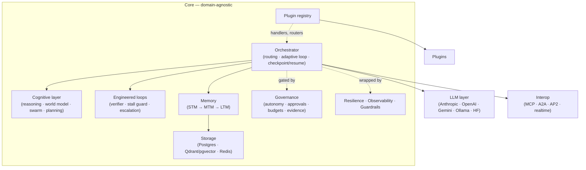

<p align="center">
  <picture>
    <source media="(prefers-color-scheme: dark)" srcset="https://raw.githubusercontent.com/baselithcore/baselithcore/main/media/full-white-og.png">
    <source media="(prefers-color-scheme: light)" srcset="https://raw.githubusercontent.com/baselithcore/baselithcore/main/media/full-black-og.png">
    
  </picture>
</p>

# BaselithCore

> **Agents that survive production.** Durable execution, enforced budgets and compliance evidence — self-hosted, with no companion SaaS.

[](https://github.com/baselithcore/baselithcore/actions/workflows/ci.yml)
[](https://pypi.org/p/baselith-core/)
[](https://www.python.org/downloads/)
[](https://github.com/baselithcore/baselithcore/blob/main/LICENSE)
[](https://github.com/baselithcore/baselithcore/blob/main/LICENSE.exception)
[](https://docs.baselithcore.xyz)

[Quick start](#quick-start) · [Plugins](#plugins) · [Operating it](#operating-it) · [Architecture](#architecture) · [Docs](https://docs.baselithcore.xyz) · [Marketplace](https://marketplace.baselithcore.xyz) · [Changelog](https://github.com/baselithcore/baselithcore/blob/main/CHANGELOG.md)

BaselithCore is a Python orchestration engine for agentic AI. Execution is
checkpointed as a run proceeds, so an interrupted process resumes from its last
completed step instead of replaying side effects. Every request carries a budget
for iterations, tool calls, tokens and USD, and every step emits OpenTelemetry
spans and Prometheus metrics with real cost attached.

- **Durable.** Checkpoint/resume, replayable tool steps, state history and fork/rewind. A `SIGKILL` mid-run recovers without repeating a side effect.
- **Controlled.** Autonomy gating, durable human approvals, per-request budgets, prompt-injection guardrails and sandboxed code execution, fail-closed by default.
- **Complete and self-hosted.** Evaluation, LLM-as-judge, red-teaming, tracing, metrics, Helm and Terraform are built in. Opt-in EU AI Act, GDPR, NIS2 and DORA primitives write their evidence while the system runs.

> **Stable since 1.0.** The public `baselith` API follows Semantic Versioning:
> a breaking change waits for a major release and a deprecation cycle. Coming
> from 0.x? See [Migrating to 1.0](https://docs.baselithcore.xyz/advanced/migrating-to-1-0/).

## Quick start

```bash
uvx --from baselith-core baselith --version     # try it without installing
uv pip install baselith-core                    # or: pip install baselith-core
```

```python
import asyncio
from baselith import Agent, Crew, Task

researcher = Agent(system_prompt="You are a meticulous researcher.")
writer = Agent(system_prompt="You write crisp executive summaries.")

crew = Crew(agents=[researcher, writer], tasks=[
    Task("Research {topic} and list the key facts.", agent=researcher),
    Task("Write a summary from the research.", agent=writer),
])


async def main() -> None:
    result = await crew.run(inputs={"topic": "vector databases"})
    print(result.final)


asyncio.run(main())
```

`baselith` is the public API and the only surface with a compatibility promise
(see [API stability tiers](https://docs.baselithcore.xyz/advanced/api-stability/)).
The [quickstart](https://docs.baselithcore.xyz/getting-started/quickstart/) adds
tools, structured output and a checkpoint store.

**The whole runtime** — API, PostgreSQL, FalkorDB, Qdrant and embedding/rerank
servers, migrations applied at startup — from a checkout, with Docker running:

```bash
uv pip install -e .
baselith setup docker-core
docker compose --env-file configs/.env.docker.core -f docker-compose.core.yml up -d --wait
baselith doctor && curl --fail http://localhost:8000/health
```

<p align="center">
  
</p>

In a project created by `baselith init`, `baselith up` does the same in one
command. Optional capabilities (RAG, browser automation, OCR, extra providers
and vector backends) install as extras: see the
[installation guide](https://docs.baselithcore.xyz/getting-started/installation/)
and the [Docker Core guide](https://github.com/baselithcore/baselithcore/blob/main/mkdocs-site/docs/getting-started/docker-core.md).

## Plugins

Everything domain-specific is a plugin, and the CLI does the plumbing:

```bash
baselith plugin create my_plugin --type agent    # agent | router | graph
baselith plugin validate my_plugin               # syntax, manifest, schema, deps, env vars
baselith plugin add my_plugin --name my_plugin --docker
baselith plugin marketplace search browser
baselith plugin add https://github.com/your-org/plugin-example --docker
```

`baselith plugin sign` writes the integrity hash a hardened deployment checks
before importing anything. Official plugins ship under `baselith.plugins`, each
signed and strictly typed: `api_routers`, `browser_agent`, `coding_agent`,
`document_sources`, `goals`, `payments`, `reasoning_agent` and `web_scraper`.
Start with the [first-plugin tutorial](https://docs.baselithcore.xyz/getting-started/first-plugin/).

> **You keep your source.** The [plugin exception](https://github.com/baselithcore/baselithcore/blob/main/LICENSE.exception) lets any
> plugin that uses the framework as a library ship under any licence, including
> a closed one. Same terms for everyone.

## Operating it

Updates are a checked, reversible operation rather than a `git pull`:

```bash
baselith update status            # core and plugins: installed vs available
baselith update check             # refresh now; exits non-zero if the check fails
baselith update preflight         # can an update be installed right now?
baselith update apply             # install the latest signed core release
baselith update rollback          # return to the commit the last update replaced
baselith update policy set ...    # auto-apply patch releases inside a maintenance window
```

Releases are verified against provenance or an ed25519 signature before
anything is touched, a failed health check rolls the install back, and every
run is audited. A security update shows in `baselith doctor` as a warning,
never a failure. See [Plugin updates](https://github.com/baselithcore/baselithcore/blob/main/mkdocs-site/docs/core-modules/plugin-updates.md).

## Architecture



Two rules hold the shape: `baselith/core/` stays domain-agnostic, and
everything domain-specific is a plugin. See the
[architecture docs](https://docs.baselithcore.xyz/architecture/overview/).

<details>
<summary><b>What's inside</b></summary>

| | |
| :-- | :-- |
| **Agents and crews** | Typed `Agent`; sequential, parallel or manager-led `Crew`; group chat → [Agent API](https://docs.baselithcore.xyz/core-modules/agent/) |
| **Durable execution** | Postgres, SQLite or in-memory checkpoints, replay, fork/rewind, async runs with webhooks → [Orchestration](https://docs.baselithcore.xyz/core-modules/orchestration/) |
| **Loops and reasoning** | Verifier-owned loops, MCTS, Tree-of-Thoughts, swarm auctions → [Loops](https://docs.baselithcore.xyz/core-modules/loops/) · [Reasoning](https://docs.baselithcore.xyz/core-modules/reasoning/) |
| **Memory and RAG** | STM→MTM→LTM, hybrid search, full RAG pipeline, Qdrant or pgvector → [Memory](https://docs.baselithcore.xyz/core-modules/memory/) |
| **Multimodal** | Vision, PDF and audio blocks, speech in and out, duplex voice with barge-in |
| **Interoperability** | MCP server and client, A2A peers, AP2 signed mandates → [MCP](https://docs.baselithcore.xyz/core-modules/mcp/) |
| **Evaluation and observability** | Trajectory eval in CI, LLM-as-judge, red-team, OTel and Prometheus with USD cost → [Evaluation](https://docs.baselithcore.xyz/core-modules/evaluation/) |
| **Self-improvement, governed** | Skill evolution and prompt search, every change eval-gated and auditable → [Skill evolution](https://docs.baselithcore.xyz/core-modules/skill-evolution/) |
| **Compliance** | EU AI Act, GDPR, NIS2, DORA primitives with evidence trails → [Regulatory](https://docs.baselithcore.xyz/advanced/regulatory-compliance/) |
| **Deployment** | Docker, Helm, Terraform, SLO rules, typed SDKs → [Deployment](https://docs.baselithcore.xyz/advanced/deployment/) |

</details>

## Contributing

Start from a [good first issue](https://github.com/baselithcore/baselithcore/issues?q=is%3Aissue+is%3Aopen+label%3A%22good+first+issue%22),
pick up a [help wanted](https://github.com/baselithcore/baselithcore/issues?q=is%3Aissue+is%3Aopen+label%3A%22help+wanted%22)
or ask in [Discussions](https://github.com/baselithcore/baselithcore/discussions).
[CONTRIBUTING.md](https://github.com/baselithcore/baselithcore/blob/main/CONTRIBUTING.md) covers setup and the quality gates every PR
passes: 13,000+ tests behind an 85% branch-coverage floor, strict typing, and
architecture and docs-consistency checks. See also
[GOVERNANCE](https://github.com/baselithcore/baselithcore/blob/main/GOVERNANCE.md), [SUPPORT](https://github.com/baselithcore/baselithcore/blob/main/SUPPORT.md), [SECURITY](https://github.com/baselithcore/baselithcore/blob/main/SECURITY.md) and
the [Code of Conduct](https://github.com/baselithcore/baselithcore/blob/main/CODE_OF_CONDUCT.md).

## Licence

**AGPL-3.0-only** ([LICENSE](https://github.com/baselithcore/baselithcore/blob/main/LICENSE)), with a section 7 permission
([LICENSE.exception](https://github.com/baselithcore/baselithcore/blob/main/LICENSE.exception)): a plugin that uses the framework as a
library, rather than patching `baselith/core/`, may carry any licence, closed
ones included. [NOTICE](https://github.com/baselithcore/baselithcore/blob/main/NOTICE) adds an attribution term: keep the file, and
credit *"Based on BaselithCore by The BaselithCore Authors"* wherever a product
shows legal notices.

---

Copyright © 2026 The BaselithCore Authors.
