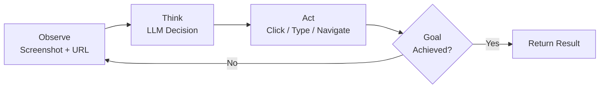
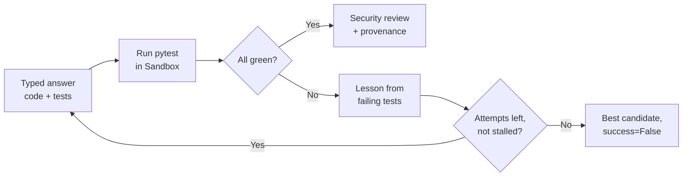

# Agentic Modules

**BrowserAgent** and **CodingAgent** live in the official plugins `baselith/plugins/browser_agent/` and `baselith/plugins/coding_agent/`, keeping the Sacred Core free from application-specific agent logic.

!!! info "The `core.agents` shim is removed"
    The historical `core.agents` entrypoints (and `core.goals`, the shim over
    `baselith.plugins.goals`) were deprecated in 0.39 and removed in 1.0.
    Import from `baselith.plugins.browser_agent` and
    `baselith.plugins.coding_agent`; see
    [Upgrade Notes](../advanced/upgrade-notes.md#the-agents-and-goals-shims-are-gone).

## Module Structure

```txt
plugins/
├── browser_agent/
│   ├── agent.py           # ReAct-loop browser automation
│   ├── tools.py           # LangChain/MCP-compatible browser tools
│   ├── types.py           # BrowserAction, PageState, BrowserAgentResult
│   └── plugin.py          # BrowserAgentPlugin
├── coding_agent/
│   ├── agent.py           # CodingAgent: public tasks, review, provenance
│   ├── flows.py           # fix / write / refactor / tests flows
│   ├── loop.py            # Verified loop on baselith.core.loops.EngineeredLoop
│   ├── harness.py         # pytest run in the sandbox, keyed report
│   ├── screening.py       # What code and tests may not reach before they run
│   ├── llm.py             # Typed answers via response_format
│   ├── schemas.py         # CodeAnswer, CodeWithTests, TestsAnswer, WorkspaceFix
│   ├── prompts.py         # System prompts and fenced task prompts
│   ├── compliance.py      # AI-system inventory, Art. 50 provenance
│   ├── tools.py           # MCP tool definitions and adapters
│   ├── workspace*.py      # fix_in_workspace: one file of a repository, verified
│   ├── types.py           # CodeLanguage, CodingResult, CodeExecutionResult
│   ├── evals/             # Fix-rate benchmark (python -m baselith.plugins.coding_agent.evals)
│   └── plugin.py          # CodingAgentPlugin
└── ...
```

---

## BrowserAgent

An autonomous agent that controls a web browser via **Playwright**, using the Vision service for page understanding.

### Architecture

Implements the **ReAct (Reason + Act)** loop:



### Usage

```python
from baselith.plugins.browser_agent import BrowserAgent

# Context manager handles Playwright lifecycle
async with BrowserAgent(headless=True) as agent:
    result = await agent.execute_task(
        "Go to google.com and search for 'Python tutorials'"
    )
    print(result.success)      # True
    print(result.final_url)    # https://www.google.com/search?q=...
    print(result.steps_taken)  # Number of actions taken
```

### Configuration

| Parameter         | Default    | Description                           |
| ----------------- | ---------- | ------------------------------------- |
| `max_steps`       | `20`       | Maximum ReAct iterations              |
| `headless`        | `True`     | Run browser headlessly                |
| `viewport_width`  | `1280`     | Browser viewport width                |
| `viewport_height` | `720`      | Browser viewport height               |
| `vision_service`  | `None`     | Injected `VisionService` instance (defaults to `VisionService()`) |

### Supported Actions

| Action     | Description   | Example                                                    |
| ---------- | ------------- | ---------------------------------------------------------- |
| `navigate` | Go to a URL   | `{"action": "navigate", "value": "https://..."}`           |
| `click`    | Click element | `{"action": "click", "selector": "button.submit"}`         |
| `type`     | Type text     | `{"action": "type", "selector": "input", "value": "text"}` |
| `scroll`   | Scroll page   | `{"action": "scroll", "value": "down"}`                    |
| `wait`     | Wait seconds  | `{"action": "wait", "value": "2"}`                         |
| `extract`  | Extract text  | `{"action": "extract", "selector": ".result"}`             |
| `done`     | Goal complete | `{"action": "done", "reasoning": "task done"}`             |

### Durability in a checkpointed run

A browser task **cannot be resumed mid-way**. Its state lives in the browser
(the current page, cookies, half-filled forms) and a resumed run starts with a
fresh browser: replaying the recorded decisions of the first steps would leave
the page where it started while the model believes it moved on, and
re-executing them would repeat whatever a click or a submit did. So when the
run has a checkpoint (the orchestrator binds it as ambient while a handler
runs), `execute_task` is durable at **whole-task** granularity
(`baselith/plugins/browser_agent/agent/durable.py`):

- the task's outcome is one checkpoint step: a resumed run whose task had
  finished replays its result and never relaunches the browser. The replayed
  `BrowserAgentResult` has `screenshots=[]` — screenshots are not persisted;
- an attempt marker is recorded when the task starts, and a write-ahead
  *effect marker* before every `click` and `type`;
- a resumed run that finds the task started but unfinished re-runs it from
  scratch **only when no effect marker was recorded** (navigating, scrolling
  and reading are safe to repeat). Otherwise it returns a failed result
  ("interrupted after it acted on a page") instead of acting twice:
  side-effecting actions are at-most-once, never retried automatically.

The individual MCP browser tools (`browser_navigate`, `browser_click`, …) are
not recorded: each is one call the caller's own tool step already covers.
Without a checkpoint nothing changes.

This stays the granularity on purpose. Everything else in a run now resumes
at the step — a typed agent's model turns, crew tasks, workflow subgraphs,
colony auctions, a stream's answer — because each of those steps is fully
described by what it returned. A browser step is not: its outcome *is* the
page state, which no record can rebuild in a new browser.

**What the operator sees** for an interrupted task that had acted:

- the task's step returns `BrowserAgentResult(success=False,
  error="the browser task was interrupted after it acted on a page (click or
  type); it is not re-run automatically, …")`, and that failure is itself
  recorded, so a further resume reports the same thing instead of trying
  again;
- the run's checkpoint trajectory shows the `attempt` step and one
  `external_side_effect` step per `click` / `type` that started — its step
  number, action and selector (the typed value only as a digest) — which is
  the list to check by hand before re-submitting the task;
- the run itself is not failed by this: the handler gets an ordinary failed
  result and decides (the default flow reports it to the caller).

An interrupted task that only navigated, scrolled or read re-runs from scratch
without any of this.

### MCP Tools Integration

```python
from baselith.plugins.browser_agent import register_browser_tools

# Register the browser tools onto an MCP server (returns None)
register_browser_tools(server)
```

---

## CodingAgent

A coding agent that writes, fixes, tests, explains and refactors code, and
**proves what it returns**: the model answers with typed JSON holding code and
pytest tests, the tests run in the [Sandbox Service](services.md), and a task
succeeds only when they ran and passed. "It exited 0" is not a pass.

**Architecture**



- **Typed answers**: Pydantic schemas (`CodeAnswer`, `CodeWithTests`,
  `TestsAnswer`) go through the LLM service's `generate(response_format=...)`,
  are validated and retried once with the error; a plain-text answer falls
  back to its fenced code blocks.
- **Tests first**: `fix_code` writes tests that reproduce the bug and freezes
  them (`tests_reproduce_bug` says whether they fail on the original code);
  `generate_code` holds the code to its first answer's tests; `refactor_code`
  pins today's behaviour with characterization tests that must pass on the
  original before the refactor is attempted; `generate_tests` runs the tests
  once against the code.
- **Verified loop** on `baselith.core.loops.EngineeredLoop`: lessons from failed
  attempts feed the next one, the stall guard ends a run stuck on the same
  failure, and the best candidate is returned on a loss.
- **Observability and compliance**: one `agent_span` per call with the outcome
  as attributes, registration in the AI-system inventory at initialize, and an
  AI Act Art. 50 provenance tag (`baselith.core.transparency`) on new code only.

**Usage**

```python
from baselith.plugins.coding_agent import CodingAgent

agent = CodingAgent(max_fix_attempts=5, execution_timeout=30)

result = await agent.fix_code(
    code="def add(a, b):\n    return a - b",
    error_message="add(2, 3) returns -1",
)
print(result.success, result.tests_passed, result.tests_total)
print(result.tests_reproduce_bug, result.loop_status)
print(result.final_code)
print(result.test_code)  # the pytest file that verified final_code

written = await agent.generate_code("is_palindrome(s) ignoring case and spaces")
tests = await agent.generate_tests(code="def add(a, b): return a + b")
refactored = await agent.refactor_code(code, goals="improve readability")
explanation = await agent.explain_code(code, language="javascript")  # nothing runs
```

Only Python executes; other languages get `explain_code`. The sandbox image
must contain pytest: `agent-sandbox:latest` built from
`baselith/core/services/sandbox/Dockerfile.sandbox` does.

### Repository fixes

`fix_in_workspace(workspace, problem)` fixes one file of a repository, with the
files it imports as read-only context, and proves the fix with tests that
import the module by its real path:

```python
ws = agent.workspace(
    files={"pkg/util.py": util_src, "pkg/mod.py": mod_src},
    target="pkg/mod.py",
    test_path="pkg/test_mod.py",
    roots=("", "src"),  # import roots: "" plus "src" for a src layout
)
result = await agent.fix_in_workspace(ws, "quad(1) returns 3, expected 4")
print(result.verified, result.success, result.diff)
```

The files are staged in a private host directory, mounted **read-only** into
the sandbox (`execute_code_async(..., mounts_read_only=True)`) and copied to
`/tmp` before anything runs, so the code under test never writes back to the
host. As with `fix_code`, tests that reproduce the problem come first and are
frozen. A workspace never carries a `conftest.py` or a pytest config file, and
pytest runs with `--noconftest` and an empty config.

When the fix cannot run, the result is an **unverified proposal**
(`verified=False`) with `unverified_reason`: `language` (not Python),
`too_large` (over 1 MB), `sandbox_unavailable` (a provider without read-only
mounts), `missing_dependency` (a third-party import the sandbox lacks) or
`probe_failed` (the target does not import as it is). The repository's CI has
to judge it. A withheld fix (security review) takes its diff with it.

### Test runs the code cannot forge

One sandbox run writes `solution.py` and `test_solution.py` under a private
`/tmp` directory and runs pytest in-process, printing one report line whose
marker carries a fresh random key. A report without the key is ignored, two
with it fail the run as tampering, and so does a process that exits non-zero
after its report (killed or exited after printing a forged line).

Before anything runs, code and tests (and every repository file of a
workspace run) are screened for what could reach the run key, the reporter or
pytest's machinery: `/proc`, `sys.orig_argv`, `os._exit`, `atexit`,
`__main__`, frames (`sys._getframe`, `inspect.currentframe`, `f_back`,
`tb_frame`, `__globals__`), `gc` object walks, `sys.modules`, `__import__`,
`importlib`, `exec`/`eval`/`compile`, process replacement (`os.exec*`,
`os.system`), pytest plugins and hooks (`pytest_plugins`, `def pytest_*`,
`hookimpl`, `.hook`), `_pytest` and pytest's node and report classes. The
screen reads three views of each file (the text NFKC-normalised, the source as
`ast.unparse` writes it back, and every string built from constants), so a
name split into pieces (`"__ma" + "in__"`), spelled with escapes or in
fullwidth letters is still caught. The `if __name__ == "__main__":` statement
of a repository file is allowed.

The run itself holds where the screen cannot see: the report line is written
with functions bound before any test code is imported (a patched `print`,
`json` or `sys.stdout` changes nothing), a skipped or xfailed test is never
green, nor is a session pytest ended early (`KeyboardInterrupt`,
`pytest.exit`), and a workspace run imports pytest before the workspace is on
`sys.path`, so a repository file named `pytest.py` is not the pytest that runs.

This raises the bar; it is not a proof against code written deliberately to
evade it (a value computed at run time is out of a screen's reach), so the
sandbox isolation and the security review below apply to every result.

### What "verified" means

A green run counts only when the tests demonstrably checked something:

- **The report adds up.** Exactly one keyed report; every collected test is
  accounted for (`collected == passed + failed + errors + skipped`, each test
  counted once by the worst of its phases, an xpass counted as a skip); at
  least one test passed. Otherwise the run is not verified with
  `reason="inconsistent_report"` (also `multiple_reports`,
  `exit_after_report`, `no_report`, `timeout`, `crash`, `refused`).
- **Assertions executed.** pytest's assertion-pass hook is enabled
  (`-o enable_assertion_pass_hook=true`) and counted by the reporter, which is
  bound before any model code is imported, together with calls to
  `pytest.raises` and `pytest.warns`. Every passing test must execute at least
  one check; a test that passes without one makes the run not verified with
  `reason="no_assertions"`. An `assert` inside the code under test is not a
  check: only the test file is rewritten.
- **Frozen tests check something.** For `fix_code`, `generate_code` and
  `fix_in_workspace`, a first test file with no `assert` and no
  `pytest.raises`/`warns`/`approx` (a static AST check) is never frozen: the
  model is asked again.

`TestReport.reason`, `collected`, `assertions` and `unasserted` carry the
verdict and the counts.

!!! warning "Limits of verification"
    The model writes both the code and the tests. A verified result shows the
    code passes the model's own tests under a best-effort tamper screen inside
    the sandbox. It is **not** proof of correctness (a trivial assertion still
    counts) and **not** a guarantee against code written deliberately to defeat
    the checks. The sandbox and the deterministic security review are the
    boundary.

### Input is data

Code, error messages, instructions, the test reports and the lessons from
earlier attempts fed back to the model pass
`baselith.core.guardrails.scan_external_content` and are fenced in the prompt between
`<<<DATA` and `DATA>>>`. Data that spells a fence marker is defused before it
is quoted: any case or spacing, lookalike brackets or letters (fullwidth,
Cyrillic, Greek), HTML entities, hidden characters, a marker split across
lines, and brackets at the edge of the data that would join the real fence.
Short values quoted inline (the language, repository file names) are reduced
to one line without backticks, markers or hidden characters. The fence lowers
the risk of prompt injection without removing it, which is why the tests and
the review decide what is returned.

### Fix-rate benchmark

`python -m baselith.plugins.coding_agent.evals` runs six real bugs through `fix_code`
with the configured model and judges each by hidden tests the agent never
sees; passing its own tests is not enough. It exits `0` only at a 100% fix
rate. `--workspace` runs the repository cases through `fix_in_workspace`
instead; positional names select cases.

### Deterministic security review

Every code-returning path (`fix_code`, `generate_code`, `generate_tests`,
`refactor_code`) funnels through the LLM-free
[code security review](guardrails.md#code-security-review)
(`baselith.core.guardrails.review_code`) before a `CodingResult` leaves the agent. It
covers the returned tests too: a high-severity finding in `test_code` replaces
them with a note and sets `success` to `False`. For the code itself:

- **`high` severity** (leaked credential, `eval`/`exec` on dynamic input)
  **withholds the code**: `final_code` is replaced with a refusal note
  listing the findings, `success` is `False`, and `error` is set — the
  agent must never ship a secret.
- **`medium`/`low`** findings ride along without blocking:
  `CodingResult.review` carries the full `CodeReview`, and the MCP tool
  payloads include a `review` entry whenever the verdict is `flagged`.

```python
result = await agent.fix_code(code, error_message)
if result.review and result.review.verdict == "flagged":
    for comment in result.review.comments:
        print(comment.severity, comment.line, comment.message)
```

### Supported Languages

```python
from baselith.plugins.coding_agent import CodeLanguage

CodeLanguage.PYTHON     # "python"
CodeLanguage.JAVASCRIPT # "javascript"
CodeLanguage.TYPESCRIPT # "typescript"
```

**MCP Tools Integration**

```python
from baselith.plugins.coding_agent import register_coding_tools

register_coding_tools(server)  # Registers coding tools onto an MCP server (returns None)
```

Every tool accepts a `language` argument, and the payloads carry the proof:
`tests_passed`/`tests_total`, the test file, the changes and, for a fix,
whether the tests reproduce the bug. `fix_code`, `generate_code`,
`generate_tests` and `refactor_code` are `destructive` (they execute
model-written code in the sandbox); `explain_code` is `read_only`.

### Durability in a checkpointed run

When the run has a checkpoint (the orchestrator binds it as ambient while a
flow handler runs, and composite runners re-bind their own scope), every
verified task — `fix_code`, `generate_code`, `generate_tests`,
`refactor_code`, `fix_in_workspace` — records its expensive steps under a
`coding_agent` child scope (`baselith/plugins/coding_agent/runner/durable.py`):

- **each typed model answer**, keyed by a digest of the prompt and the answer
  schema;
- **each sandbox test run** (the workspace import probe and the reproduction
  run on the original code included), keyed by a digest of the code and the
  tests, with its full `TestReport`.

The loop is deterministic given those results — the lessons and evidence each
prompt carries come from the recorded reports — so a run resumed after a crash
replays the answers and runs it already paid for and continues from the first
step that never finished: a crash during attempt 3 costs attempt 3, not
attempts 1–3. A prompt that differs for any reason simply misses and runs for
real. A lost lease (`CheckpointConflictError`) stops the task instead of
being reported as a failed attempt. `explain_code` (one call, nothing
executed) is not recorded. Without a checkpoint nothing changes.

---

## Security Notes

!!! warning "Sandbox Required"
    The `CodingAgent` **requires** the Sandbox Service (Docker-based execution). It will refuse to run code locally, preventing arbitrary code execution on the host.

!!! info "Vision Dependency"
    The `BrowserAgent` requires a configured Vision provider (Ollama, OpenAI, or Anthropic). Make sure `VISION_PROVIDER` is set in your `.env`.
