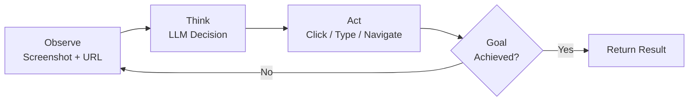
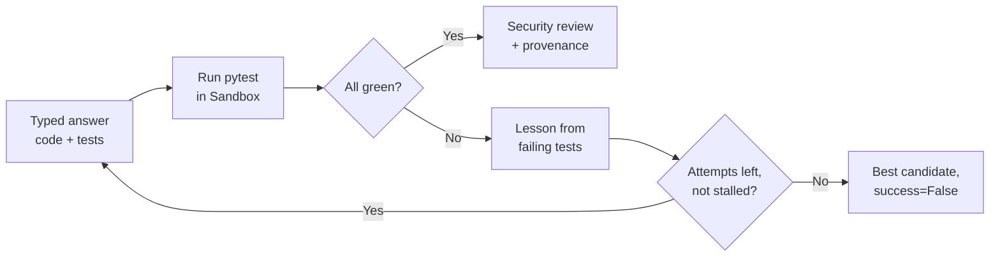

# Agentic Modules

The historical `core/agents/` entrypoints are now **compatibility shims**. The canonical implementations of **BrowserAgent** and **CodingAgent** live in the official plugins `plugins/browser_agent/` and `plugins/coding_agent/`, keeping the Sacred Core free from application-specific agent logic.

!!! info "Current State"
    Existing imports from `core.agents` remain supported for backward compatibility, but new code should prefer the plugin packages directly. Importing `core.agents` (like `core.goals`, the shim over `plugins.goals`) emits a `DeprecationWarning`: deprecated since 0.39, removed in 1.0.

## Module Structure

```txt
plugins/
├── browser_agent/
│   ├── agent.py           # ReAct-loop browser automation
│   ├── tools.py           # LangChain/MCP-compatible browser tools
│   ├── types.py           # BrowserAction, PageState, BrowserAgentResult
│   └── plugin.py          # BrowserAgentPlugin
├── coding_agent/
│   ├── agent.py           # CodingAgent: public tasks, review, provenance
│   ├── flows.py           # fix / write / refactor / tests flows
│   ├── loop.py            # Verified loop on core.loops.EngineeredLoop
│   ├── harness.py         # pytest run in the sandbox, keyed report
│   ├── llm.py             # Typed answers via response_format
│   ├── schemas.py         # CodeAnswer, CodeWithTests, TestsAnswer
│   ├── prompts.py         # System prompts and fenced task prompts
│   ├── compliance.py      # AI-system inventory, Art. 50 provenance
│   ├── tools.py           # MCP tool definitions and adapters
│   ├── types.py           # CodeLanguage, CodingResult, CodeExecutionResult
│   ├── evals/             # Fix-rate benchmark (python -m plugins.coding_agent.evals)
│   └── plugin.py          # CodingAgentPlugin
└── ...

core/agents/
├── browser_agent.py       # Backward-compatible shim
├── browser_tools.py       # Backward-compatible shim
├── browser_types.py       # Backward-compatible shim
├── coding/                # Backward-compatible shim package
│   ├── __init__.py
│   ├── agent.py           # -> plugins.coding_agent.agent
│   ├── prompts.py         # -> plugins.coding_agent.prompts
│   └── types.py           # -> plugins.coding_agent.types
└── coding_tools.py        # Backward-compatible shim
```

---

## BrowserAgent

An autonomous agent that controls a web browser via **Playwright**, using the Vision service for page understanding.

### Architecture

Implements the **ReAct (Reason + Act)** loop:



### Usage

```python
from plugins.browser_agent import BrowserAgent

# Context manager handles Playwright lifecycle
async with BrowserAgent(headless=True) as agent:
    result = await agent.execute_task(
        "Go to google.com and search for 'Python tutorials'"
    )
    print(result.success)      # True
    print(result.final_url)    # https://www.google.com/search?q=...
    print(result.steps_taken)  # Number of actions taken
```

### Configuration

| Parameter         | Default    | Description                           |
| ----------------- | ---------- | ------------------------------------- |
| `max_steps`       | `20`       | Maximum ReAct iterations              |
| `headless`        | `True`     | Run browser headlessly                |
| `viewport_width`  | `1280`     | Browser viewport width                |
| `viewport_height` | `720`      | Browser viewport height               |
| `vision_service`  | `None`     | Injected `VisionService` instance (defaults to `VisionService()`) |

### Supported Actions

| Action     | Description   | Example                                                    |
| ---------- | ------------- | ---------------------------------------------------------- |
| `navigate` | Go to a URL   | `{"action": "navigate", "value": "https://..."}`           |
| `click`    | Click element | `{"action": "click", "selector": "button.submit"}`         |
| `type`     | Type text     | `{"action": "type", "selector": "input", "value": "text"}` |
| `scroll`   | Scroll page   | `{"action": "scroll", "value": "down"}`                    |
| `wait`     | Wait seconds  | `{"action": "wait", "value": "2"}`                         |
| `extract`  | Extract text  | `{"action": "extract", "selector": ".result"}`             |
| `done`     | Goal complete | `{"action": "done", "reasoning": "task done"}`             |

### MCP Tools Integration

```python
from plugins.browser_agent import register_browser_tools

# Register the browser tools onto an MCP server (returns None)
register_browser_tools(server)
```

---

## CodingAgent

A coding agent that writes, fixes, tests, explains and refactors code, and
**proves what it returns**: the model answers with typed JSON holding code and
pytest tests, the tests run in the [Sandbox Service](services.md), and a task
succeeds only when they ran and passed. "It exited 0" is not a pass.

**Architecture**



- **Typed answers**: Pydantic schemas (`CodeAnswer`, `CodeWithTests`,
  `TestsAnswer`) go through the LLM service's `generate(response_format=...)`,
  are validated and retried once with the error; a plain-text answer falls
  back to its fenced code blocks.
- **Tests first**: `fix_code` writes tests that reproduce the bug and freezes
  them (`tests_reproduce_bug` says whether they fail on the original code);
  `generate_code` holds the code to its first answer's tests; `refactor_code`
  pins today's behaviour with characterization tests that must pass on the
  original before the refactor is attempted; `generate_tests` runs the tests
  once against the code.
- **Verified loop** on `core.loops.EngineeredLoop`: lessons from failed
  attempts feed the next one, the stall guard ends a run stuck on the same
  failure, and the best candidate is returned on a loss.
- **Observability and compliance**: one `agent_span` per call with the outcome
  as attributes, registration in the AI-system inventory at initialize, and an
  AI Act Art. 50 provenance tag (`core.transparency`) on new code only.

**Usage**

```python
from plugins.coding_agent import CodingAgent

agent = CodingAgent(max_fix_attempts=5, execution_timeout=30)

result = await agent.fix_code(
    code="def add(a, b):\n    return a - b",
    error_message="add(2, 3) returns -1",
)
print(result.success, result.tests_passed, result.tests_total)
print(result.tests_reproduce_bug, result.loop_status)
print(result.final_code)
print(result.test_code)  # the pytest file that verified final_code

written = await agent.generate_code("is_palindrome(s) ignoring case and spaces")
tests = await agent.generate_tests(code="def add(a, b): return a + b")
refactored = await agent.refactor_code(code, goals="improve readability")
explanation = await agent.explain_code(code, language="javascript")  # nothing runs
```

Only Python executes; other languages get `explain_code`. The sandbox image
must contain pytest: `agent-sandbox:latest` built from
`core/services/sandbox/Dockerfile.sandbox` does.

### Test runs the code cannot forge

One sandbox run writes `solution.py` and `test_solution.py` under a private
`/tmp` directory and runs pytest in-process, printing one report line whose
marker carries a fresh random key. A report without the key is ignored and two
with it fail the run as tampering. Code or tests that read `/proc`, call
`os._exit`, register `atexit` hooks or reach for the reporter (`__main__`,
`sys._getframe`, `gc.get_referrers`, pytest's `pluginmanager`) are refused
before anything runs. This raises the bar; it is not a proof against code
written deliberately to evade it, so the sandbox isolation and the security
review below apply to every result.

### Input is data

Code, error messages, instructions and the test reports fed back to the model
pass `core.guardrails.scan_external_content` and are fenced in the prompt
between `<<<DATA` and `DATA>>>`; data that itself spells a fence marker is
defused before it is quoted. The fence lowers the risk of prompt injection
without removing it, which is why the tests and the review decide what is
returned.

### Fix-rate benchmark

`python -m plugins.coding_agent.evals` runs six real bugs through `fix_code`
with the configured model and judges each by hidden tests the agent never
sees; passing its own tests is not enough. It exits `0` only at a 100% fix
rate.

### Deterministic security review

Every code-returning path (`fix_code`, `generate_code`, `generate_tests`,
`refactor_code`) funnels through the LLM-free
[code security review](guardrails.md#code-security-review)
(`core.guardrails.review_code`) before a `CodingResult` leaves the agent. It
covers the returned tests too: a high-severity finding in `test_code` replaces
them with a note and sets `success` to `False`. For the code itself:

- **`high` severity** (leaked credential, `eval`/`exec` on dynamic input)
  **withholds the code**: `final_code` is replaced with a refusal note
  listing the findings, `success` is `False`, and `error` is set — the
  agent must never ship a secret.
- **`medium`/`low`** findings ride along without blocking:
  `CodingResult.review` carries the full `CodeReview`, and the MCP tool
  payloads include a `review` entry whenever the verdict is `flagged`.

```python
result = await agent.fix_code(code, error_message)
if result.review and result.review.verdict == "flagged":
    for comment in result.review.comments:
        print(comment.severity, comment.line, comment.message)
```

### Supported Languages

```python
from plugins.coding_agent import CodeLanguage

CodeLanguage.PYTHON     # "python"
CodeLanguage.JAVASCRIPT # "javascript"
CodeLanguage.TYPESCRIPT # "typescript"
```

**MCP Tools Integration**

```python
from plugins.coding_agent import register_coding_tools

register_coding_tools(server)  # Registers coding tools onto an MCP server (returns None)
```

Every tool accepts a `language` argument, and the payloads carry the proof:
`tests_passed`/`tests_total`, the test file, the changes and, for a fix,
whether the tests reproduce the bug. `fix_code`, `generate_code`,
`generate_tests` and `refactor_code` are `destructive` (they execute
model-written code in the sandbox); `explain_code` is `read_only`.

---

## Security Notes

!!! warning "Sandbox Required"
    The `CodingAgent` **requires** the Sandbox Service (Docker-based execution). It will refuse to run code locally, preventing arbitrary code execution on the host.

!!! info "Vision Dependency"
    The `BrowserAgent` requires a configured Vision provider (Ollama, OpenAI, or Anthropic). Make sure `VISION_PROVIDER` is set in your `.env`.
