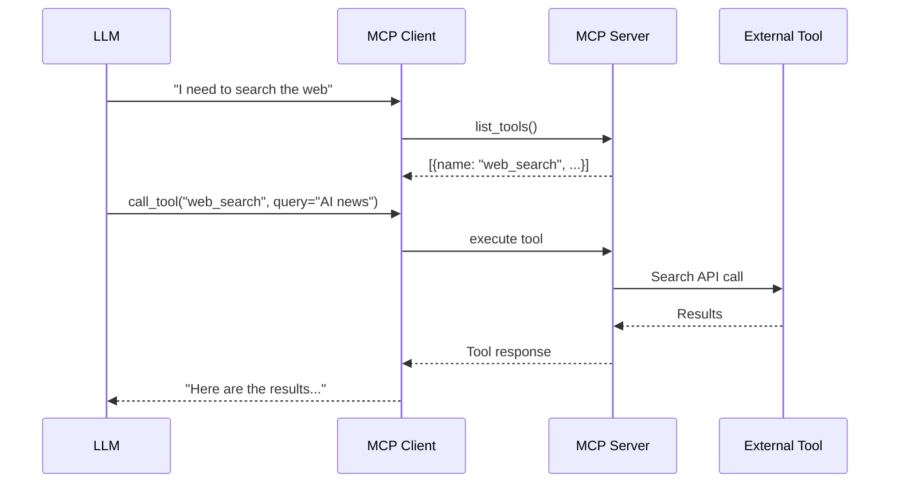

The `core/mcp` module implements the **Model Context Protocol** (MCP) to dynamically extend agent capabilities with external tools.

## What is MCP

The **Model Context Protocol** is an open standard for connecting LLMs to external data sources and tools in a secure and structured way.

### Problem Solved

LLMs are limited to:

- Static knowledge (training cutoff date)
- Inability to interact with external systems
- No access to real-time data

**Solution**: MCP allows LLMs to "call" external tools (APIs, databases, calculators, browsers) during generation.

### How It Works



### Benefits

**Extensibility**: Add new tools without model retraining

**Security**: Tools executed server-side with access control

**Standardization**: Common protocol across providers (OpenAI, Anthropic, etc.)

**Hot-Swappable**: Enable/disable tools without restart

---

## Transports

Two transports are supported on both sides:

**stdio** (default): the client spawns the server as a child process and
exchanges newline-delimited JSON-RPC 2.0 messages over the process's
stdin/stdout. This is the transport used by Claude Desktop and most MCP-aware
IDEs.

**Streamable HTTP** (opt-in, dual-era):

- **Server** — `MCP_HTTP_TRANSPORT_ENABLED=true` mounts the MCP server on the
  API surface at `MCP_HTTP_PATH` (default `/mcp`,
  `core/mcp/http_transport.py`). One JSON-RPC message per `POST` (batching was
  removed in 2025-06-18; arrays get `400`), `GET` returns `405` (no
  server-initiated stream). `create_app()` keeps the server on
  `app.state.mcp_server`; each plugin's `get_mcp_tools()` is registered on it
  as the plugin activates — see [Plugin tools](#plugin-tools).
- **Modern requests (2026-07-28)** are **stateless**: no session is required or
  minted, and a stale `Mcp-Session-Id` is ignored. They must carry the standard
  headers, validated against the body
  (`core/mcp/http_headers.py`) — a proxy routing on `Mcp-Name` while the server
  executes the body value is the confused-deputy split this closes:

    | Header | Mirrors | Required for |
    |--------|---------|--------------|
    | `MCP-Protocol-Version` | `_meta` protocol version | all requests |
    | `Mcp-Method` | `method` | all requests |
    | `Mcp-Name` | `params.name` / `params.uri` | `tools/call`, `resources/read`, `prompts/get` |

    A missing or mismatched header is `400` + `-32020`; values outside
    header-safe ASCII travel as `=?base64?…?=` and are decoded before
    comparison. Unsupported version → `400` + `-32022`; unknown method →
    `404` + `-32601` (the JSON-RPC body distinguishes it from a host that has
    no MCP endpoint at all).

- **Legacy requests** keep the session flow: `initialize` mints an
  `Mcp-Session-Id` response header; later requests must echo it
  (unknown/expired → `404`, the client re-initializes) and may carry
  `MCP-Protocol-Version` (unsupported → `400`); `DELETE` terminates the
  session.
- **Client** — `MCPClient(url="https://host/mcp", http_headers={...})`
  (`core/mcp/http_client_transport.py`): session capture/echo, negotiated
  protocol-version header, JSON and SSE response bodies, best-effort `DELETE`
  on `disconnect()`.

!!! warning "HTTP transport security (fail-closed defaults)"
    - **Authorization** — `MCP_HTTP_REQUIRE_AUTH` defaults to **true**: the
      request must carry credentials accepted by the central `AuthManager`
      (`Authorization: Bearer` JWT — local HS256 or federated OIDC — or an
      API key); anonymous callers get `401` +
      `WWW-Authenticate: Bearer resource_metadata="…"`.
      This makes the endpoint an OAuth **resource server** in the sense of
      the MCP authorization spec; token *issuance* (authorization server,
      client registration) belongs to your IdP, configured via the
      existing `OIDC_*` settings. Client-side, pass the token via
      `http_headers={"Authorization": "Bearer <token>"}`.
    - **Capability check** — authenticating is not authorizing. The identity
      must also hold `MCP_HTTP_REQUIRED_SCOPE` (default `mcp:invoke`);
      otherwise `403` with JSON-RPC code `-32002`. Set it empty to disable the
      check. See [Capability gate](#capability-gate) below.
    - **Rate limiting** — every request is metered per identity against
      `MCP_HTTP_RATE_LIMIT_PER_MINUTE` (default `120`, `0` disables), because
      each one spawns server-side work and a streaming task. Over budget the
      response carries the limiter's own status (`429`, or `503` when the
      backend is down and `RATE_LIMIT_FAIL_MODE=closed`) with JSON-RPC code
      `-32003` and the limiter's own `Retry-After` / `RateLimit-*` headers.
    - **Failed-credential throttle** — a *presented* credential that fails
      authentication is charged to the same per-source `authfail:<bucket>`
      window the REST surface uses (`AUTH_FAILURE_LIMIT_PER_MINUTE` per
      `RATE_LIMIT_WINDOW_SECONDS`). The bucket is the IPv4 address, while an
      IPv6 client is keyed by its `/64` network (an IPv4-mapped address by the
      embedded IPv4), so rotating addresses inside one allocation does not
      reset the budget. The endpoint is not an unmetered 401
      oracle for credential stuffing. Once spent the answer is `429` (JSON-RPC
      `-32003`, with `Retry-After`) instead of `401`. A request carrying no
      `Authorization` header — the spec's discovery step — is not charged.
    - **Protected-resource metadata (RFC 9728)** — while auth is required the
      router also serves an *unauthenticated*
      `GET /.well-known/oauth-protected-resource/mcp` — the metadata path
      suffixed with `MCP_HTTP_PATH` (plus the bare
      `/.well-known/oauth-protected-resource` alias) publishing this
      resource's identifier and its `authorization_servers`. That list comes
      from `MCP_HTTP_AUTHORIZATION_SERVERS` (comma-separated), falling back to
      `OIDC_ISSUER`; with neither set the field is omitted and a warning is
      logged, because an OAuth client then has no way to discover where to get
      a token.
    - **Origin allowlist** — browser-originated requests (an `Origin` header)
      are rejected unless allowlisted in `MCP_HTTP_ALLOWED_ORIGINS`
      (DNS-rebinding defense). Non-browser clients are unaffected.
    - **Autonomy gate** — the HTTP-mounted server is created with the default
      SUPERVISED `AutonomyPolicy`: tool categories requiring human approval
      are rejected fail-closed (HTTP carries no approval channel).
    - **Session ownership** — a legacy session is bound to the identity that
      minted it: `touch` and `DELETE` refuse a session that belongs to someone
      else, and `MCP_HTTP_MAX_SESSIONS_PER_CLIENT` (default 64) is counted per
      owner. With `MCP_HTTP_REQUIRE_AUTH=false` the owner is the peer address
      rather than a single shared `None`, so unauthenticated clients can no
      longer ride, terminate, or exhaust each other's sessions.
    - Sessions expire after `MCP_HTTP_SESSION_TTL_SECONDS` (default 3600) and
      are **Redis-backed when the deployment already declares
      `CACHE_BACKEND=redis`** — see [Session storage](#session-storage).
    - **Audience binding (RFC 8707)** — a bearer token whose `aud` names a
      different resource is refused (`401`, JSON-RPC `-32001`); see [Audience
      binding](#audience-binding).

### Capability gate

Admission for the HTTP transport lives in `core/mcp/http_authz.py`
(`build_gate`), which `http_transport.py` calls once per request: origin →
authentication → capability → metering. The capability step exists because
authentication alone said nothing about *what* the caller may do — every
authenticated identity, including a least-privilege API key minted for an
unrelated resource, reached `tools/list`, `resources/read` and `tools/call`.

| Identity | Holds `mcp:invoke`? | Result |
|----------|---------------------|--------|
| `admin` role | yes (via the `*` superuser scope) | unchanged |
| `service`, `user`, `job` roles | yes (in `ROLE_SCOPES`) | unchanged |
| `guest` role | no | `403` + `-32002` |
| Scoped API key (`API_KEYS_SCOPED`) | only if granted explicitly | `403` + `-32002` |

Role-based identities are therefore unaffected by default. A scoped key that
must reach MCP needs the capability spelled out — the `scoped` role implies no
scopes at all:

```bash
API_KEYS_SCOPED="sk_mcp=mcp:invoke|chat:read"
```

The scope is declared in `core/auth/scopes.py` (`SCOPE_MCP_INVOKE`) and is part
of `KNOWN_SCOPES`, so it validates like any other capability — see [Auth ›
Capability Scopes](auth.md#capability-scopes-fine-grained-authorization).

### Audience binding (RFC 8707) {#audience-binding}

A token is valid **for a resource**. Without that check, a token an authorization
server minted for an unrelated service — or one lifted from it — reached this
endpoint's whole tool catalog. The gate's fourth step compares the caller's `aud`
claim against this endpoint's canonical resource identifier:

| Token shape | Outcome with the check on |
|---|---|
| `aud` names this resource — the full endpoint URL *or* its bare origin, both listed as canonical by the MCP authorization spec | accepted |
| `aud` names a different resource | `401` + JSON-RPC `-32001`, `WWW-Authenticate: Bearer error="invalid_token"` |
| no `aud` at all | same refusal — an unbound token |
| API key (no `Authorization: Bearer`) | **exempt**: an API key has no issuer and no audience, so there is nothing to bind |

Scheme and host compare case-insensitively and a trailing slash is insignificant;
anything else — a differing path — is a different resource.

| Setting | Default | Meaning |
|---|---|---|
| `MCP_RESOURCE_URL` | `""` | Pins the canonical resource identifier. Unset, it is derived from `request.base_url`, which comes from the `Host` header — so unless the deployment pins the host (`TRUSTED_HOSTS`), a caller chooses what this endpoint claims to be. Mounting the HTTP transport with neither this nor `TRUSTED_HOSTS` set logs an **ERROR** (`mcp_http_resource_unpinned`). |
| `MCP_REQUIRE_TOKEN_AUDIENCE` | unset (`None`) | Resolves **at request time** to the runtime posture: enforced in production, off elsewhere. `false` stands the whole check down. |

`resource_identifier()` is the single source of both the value published as
`resource` in the protected-resource metadata and the value the `aud` claim is
compared against, so advertised and enforced cannot drift.

!!! warning "This can lock out existing clients"
    `JWT_AUDIENCE` is pinned once per deployment, so the outcome is binary: either
    the issued audience is this endpoint's resource identifier or *every* token
    mismatches and the endpoint is unreachable. Before enabling this in production,
    either request the MCP resource URL via the RFC 8707 `resource` parameter when
    obtaining tokens, or set `MCP_RESOURCE_URL` to the audience your tokens already
    carry. `MCP_REQUIRE_TOKEN_AUDIENCE=false` is the lever if you cannot reissue
    today.

### Session storage {#session-storage}

The legacy era mints an `Mcp-Session-Id` at `initialize` and expects every later
request to present it. `build_session_store()` (`core/mcp/http_sessions.py`) picks
the backing store automatically — no new setting to discover:

| Deployment | Store | Behaviour |
|---|---|---|
| `CACHE_BACKEND=redis` | `RedisSessionStore` | Sessions, owner binding and the per-owner cap are shared across replicas. Keys are `mcp:session:id:<sid>` (owner, TTL'd by Redis) and `mcp:session:owner:<owner>` (a hash of `sid → expiry`, used only for the cap). |
| anything else | `SessionStore` | Process-local, the historical behaviour. Streamable HTTP sessions are then an affinity contract between one client and one server instance, and the spec's recovery path — a `404` answered by re-initializing — covers failover. |

The namespace is deliberately distinct from the application cache's own prefix, so
flushing a cache never strands live sessions. A Redis failure **degrades** to the
process-local store with a warning rather than failing the request: every request
is still authenticated, authorized, metered and owner-bound; only the sharing of
the session across replicas is lost.

!!! warning "`SessionStore` methods are now async"
    Both stores implement one **async** interface, so `create`, `touch`,
    `terminate` and friends must be awaited. `SessionStore` keeps its name and its
    `core.mcp.http_transport` import path; only the call shape changed.

## Protocol eras

The server is **dual-era** (`core/mcp/modern.py`). It serves:

| Era | Versions | Selected by |
|-----|----------|-------------|
| **Modern** | `2026-07-28` | `_meta["io.modelcontextprotocol/protocolVersion"]` on the request |
| **Legacy** | `2025-11-25` … `2024-11-05` | an `initialize` handshake |

The era marker is per request, so both can run against the same process or
endpoint. Handler bodies are era-agnostic: the dispatcher validates the modern
metadata on the way in and shapes the modern result on the way out.

### Modern era (2026-07-28)

`2026-07-28` removed the handshake and protocol-level sessions. Every request
carries its own metadata and every result carries the server's:

```json
{
  "jsonrpc": "2.0", "id": 1, "method": "tools/list",
  "params": {
    "_meta": {
      "io.modelcontextprotocol/protocolVersion": "2026-07-28",
      "io.modelcontextprotocol/clientCapabilities": {},
      "io.modelcontextprotocol/clientInfo": {"name": "ExampleClient", "version": "1.0.0"}
    }
  }
}
```

- **`server/discover`** (mandatory) returns `supportedVersions`, `capabilities`
  and identity in one cacheable request — everything `initialize` used to
  carry. It answers bare too, which is the stdio era probe.
- **`resultType: "complete"`** on every result, plus
  `_meta["io.modelcontextprotocol/serverInfo"]`. `"input_required"` is the MRTR
  interim value; this server never asks the client for input, so it never
  emits one.
- **Caching hints** — `ttlMs` (`MCP_CACHE_TTL_MS`, default 60000) and
  `cacheScope` (`MCP_CACHE_SCOPE`, default **`private`**) on `server/discover`,
  the three `*/list` operations, `resources/templates/list` and
  `resources/read`. `private` is the safe default: listings and reads may be
  filtered per identity, and a shared cache would leak them across
  authorization contexts. Set `public` only when every caller sees the same
  primitives.
- **Version negotiation without a handshake** — an unsupported version returns
  `-32022` with `data.supported` / `data.requested` so the client can retry;
  a request missing `clientCapabilities` is `-32602`.
- **Removed methods** — `ping` and `logging/setLevel` return `-32601` in the
  modern era and keep working for legacy clients. The log level travels
  per-request in `_meta` instead.
- **Renumbered errors** — resource-not-found is `-32602` for modern clients and
  `-32002` for legacy ones (the revision retired `-32002`).

Legacy behaviour is untouched: a legacy result carries no `resultType`,
`_meta` or caching hints, since those fields do not exist in its revision.

### Legacy handshake

`initialize` echoes the client's requested version when supported and
otherwise offers `LATEST_PROTOCOL_VERSION = "2025-11-25"`. Per that revision,
`serverInfo` carries the optional `description` field and input-validation
failures on `tools/call` are returned as **tool execution errors**
(`isError: true`, SEP-1303) so the calling model can self-correct — never as
JSON-RPC protocol errors.

### Tool annotations

`tools/list` emits 2025-06-18 **annotations** (behavioural hints) derived from
each tool's autonomy `category`, so a client can gate side-effecting tools
without executing them:

| `category` | `readOnlyHint` | `destructiveHint` | `idempotentHint` | `openWorldHint` |
|------------|:---:|:---:|:---:|:---:|
| `read_only` | ✅ | ❌ | ✅ | ❌ |
| `mutating` | ❌ | ❌ | ❌ | ❌ |
| `destructive` | ❌ | ✅ | ❌ | ❌ |
| `external_side_effect` | ❌ | ✅ | ❌ | ✅ |

These hints complement the server-side autonomy gate (`tools/call` still
rejects categories requiring human approval).

### Capability advertisement

`ServerCapabilities` members are emitted as objects or **omitted entirely** —
never as JSON `null`, which strictly-typed clients reject. A sub-capability is
advertised only when it is actually implemented **and reachable by the client
being answered**: a capability is a promise, and the two eras can honour
different ones.

| Sub-capability | Legacy (`initialize`) | Modern (`server/discover`) | Why |
|---|:---:|:---:|---|
| `listChanged` on `tools`/`resources`/`prompts` | omitted | `true` | The server pushes `notifications/*/list_changed` on a `subscriptions/listen` response stream, and only 2026-07-28 has one. A legacy client was being promised notifications it has no channel to receive; it is told to re-list instead. |
| `extensions` (`io.modelcontextprotocol/tasks`) | omitted | advertised | Every `tasks/*` method answers *method not found* outside the modern era. |
| `logging` | advertised when `MCPServerCapabilities.logging` is on (the default) | omitted | `logging/setLevel` was removed in 2026-07-28; a modern client carries its level in each request's `_meta`. |

The era is read off the *message*, not off connection state — `initialize` is a
legacy-only method and `server/discover` a modern-only one — which is what makes
this safe on a stateless transport. `completions` is advertised when any
completion handler is registered; `prompts` follows what is actually registered
rather than a static server trait.

Advertising `logging` obliges the server to answer `logging/setLevel` for legacy
clients; it accepts the eight RFC 5424 severities and rejects anything else.

`ping` is answered with an **empty** result object, per the spec.

### JSON Schema dialect

Tool `inputSchema` and `outputSchema` validators are compiled against **JSON
Schema 2020-12** (SEP-1613 makes it the default MCP dialect). A schema carrying
an explicit `$schema` still selects its own draft. This matters: a Draft-7
validator silently ignores 2019-09+ keywords such as `prefixItems`, so those
constraints would go unenforced and malformed arguments would reach the handler.

### Structured tool output

A tool may declare an `output_schema`; it is advertised as `outputSchema` on
`tools/list`, and `tools/call` then returns the payload as
`structuredContent` — mirrored as serialized JSON in a text block for clients
that only read `content` (2025-06-18):

```python
@server.tool(
    name="weather",
    description="Current weather",
    input_schema={"type": "object", "properties": {"city": {"type": "string"}}},
    output_schema={
        "type": "object",
        "properties": {"temp_c": {"type": "number"}, "city": {"type": "string"}},
        "required": ["temp_c", "city"],
    },
)
async def weather(city: str) -> dict:
    return {"temp_c": 21.5, "city": city}
```

The declared schema is a contract: output that violates it is returned as a
**tool execution error** (`isError: true`) rather than shipped to the client.

### Tool failures vs protocol errors

Exceptions raised *inside* a tool handler become `isError: true` results, never
JSON-RPC errors — the model needs to see them to retry or route around them.
Protocol-level problems keep their spec codes:

| Condition | Code |
|-----------|-----:|
| Unknown tool, malformed arguments container, invalid cursor | `-32602` |
| Unknown resource URI (no resource and no matching template) | `-32002` |
| Unknown method | `-32601` |
| Server fault | `-32603` |

The exception's **text** does not reach the model. An exception message names
DSNs, filesystem paths and driver internals, and a `tools/call` result crosses a
trust boundary to an external client, so the result reads
`Tool 'x' failed. Error id: <12 hex>` while `mcp_tool_execution_failed` logs the
same correlation id alongside the full text and `error_type`. Input-validation
messages (SEP-1303) stay verbatim — those are the model's to act on.

### Tool call limits

Two server-side bounds apply to every `tools/call`, on the synchronous path and
inside the `tasks/*` runner alike:

| Setting | Default | Behaviour when exceeded |
|---|---|---|
| `MCP_TOOL_CALL_TIMEOUT_SECONDS` | `60.0` | The handler is **cancelled** (so its own cleanup runs) and the result is an execution error: `Tool 'x' timed out after 60.0s and was cancelled.` `0` disables the deadline. |
| `MCP_MAX_TOOL_RESULT_BYTES` | `1048576` (1 MiB) | The text blocks collapse into one truncated block plus a notice, `structuredContent` is **dropped** (a cut object would violate the schema the tool declared), `isError` stays `false`, and `_meta` carries `truncated: true`, `originalBytes` and `maxBytes`. `0` disables the cap. |

A hung tool otherwise pins the request — and on HTTP the connection behind it —
for the life of the process, and an unbounded result exhausts the calling model's
context long before it exhausts the transport.

### Pagination

`tools/list`, `resources/list` and `resources/templates/list` page through an
opaque `cursor`, at most `MCP_LIST_PAGE_SIZE` entries (default 100) per page;
`nextCursor` is present only while another page exists. Entries are served in
sorted order, so a client can cache the listing. The cursor encodes the *last
key served*, not an index — entries registered or removed between pages
therefore cannot make the listing skip or repeat. A cursor this server did not
mint is rejected with `-32602` instead of silently restarting the listing.

### Resource templates

Parameterized resources are registered with `register_resource_template()` and
listed by `resources/templates/list`. Templates are RFC 6570 Level 1 (`{var}`),
each variable matching a single path segment; a `resources/read` whose URI
matches invokes `handler(uri, **variables)`:

```python
server.register_resource_template(
    uri_template="mcp://reports/{year}/{month}",
    name="Monthly report",
    description="One report per month",
    handler=read_report,           # async def read_report(uri, year, month) -> str
    mime_type="text/markdown",
)
```

Templates never appear in `resources/list` — that operation lists concrete,
directly readable URIs only.

### Prompts

Prompts are the third server primitive: templated messages a host surfaces as
slash commands or menu entries. `register_prompt()` declares the arguments;
the handler receives them as keywords and returns either a string (rendered as
one user message) or an explicit list of `PromptMessage` dicts.

```python
server.register_prompt(
    name="code_review",
    description="Ask for a code review",
    arguments=[{"name": "language", "description": "Source language", "required": True}],
    handler=review,                 # async def review(language: str) -> str
    completions={"language": ["python", "rust"]},
)
```

A missing required argument, or an unknown prompt name, is `-32602`. The
`prompts` capability is advertised as soon as a prompt is registered — the flag
follows what the server actually serves.

### Argument completion

`completion/complete` answers with candidates for one prompt argument or one
resource-template variable. A provider is either a static list (filtered here
by the prefix typed so far) or a callable — sync or async — receiving the
partial value, which is what a database- or API-backed provider needs:

```python
server.register_resource_template(
    uri_template="mcp://reports/{year}",
    name="Reports", description="", handler=read_report,
    completions={"year": lambda partial: fetch_years(partial)},
)
```

Responses are capped at 100 values with `total`/`hasMore` reporting the real
count. A provider that raises returns an empty list rather than failing the
request the user is typing into, and the `completions` capability is advertised
only when some primitive declares one.

### Icons

Tools, resources, resource templates and prompts accept `icons=[{"src",
"mimeType", "sizes"}]` (SEP-973) and emit the field only when set.

---

### Multi round-trip requests (MRTR)

2026-07-28 removed server-initiated requests. A handler that needs elicitation,
sampling or a roots listing raises `InputRequired`; `tools/call`,
`prompts/get` and `resources/read` turn that into an `InputRequiredResult`, and
the client retries the original request with the answers:

```python
from core.mcp.mrtr import InputRequired, get_input_responses

async def login(repo: str) -> str:
    answers = get_input_responses()
    if "github_login" not in answers:
        raise InputRequired(
            {"github_login": {"method": "elicitation/create", "params": {...}}},
            state={"repo": repo},          # sealed into requestState
        )
    return f"{answers['github_login']['content']['name']}@{repo}"
```

The retry is an independent request, so whatever the server must remember
travels in `requestState` — **through the client**, which makes it
attacker-controlled. `RequestStateSealer` therefore HMAC-seals it and binds it
to three things, each rejected on mismatch:

| Bound to | Blocks |
|----------|--------|
| the signature | forgery and tampering |
| the authenticated principal | cross-user replay |
| the originating method | moving state to a different request |
| a short expiry (`MCP_REQUEST_STATE_TTL_SECONDS`, default 300s) | long-lived replay |

Set `MCP_REQUEST_STATE_SECRET` in any multi-replica deployment: without it each
process mints a random key, so a retry landing on another replica is rejected.

A server never asks for something the client did not declare — an
`elicitation/create` to a client without the `elicitation` capability is
`-32021` with `data.requiredCapabilities`, not a request the client cannot
answer. A **legacy** client gets a tool execution error instead, since its
revision has no way to carry the ask.

Client-side this is transparent: pass an `input_provider` and `MCPClient`
fulfils each ask and retries, bounded to four rounds.

```python
async def provide(requests): ...          # returns the InputResponses map

async with MCPClient("./server.py", input_provider=provide) as client:
    await client.call_tool("login", {"repo": "acme"})
```

Without an `input_provider` the client declares no such capability, so a
conforming server will not ask.

### Long-running work: the tasks extension

`io.modelcontextprotocol/tasks` replaces the response with a durable handle, so
a slow operation does not hold a connection open past an intermediary's
timeout and survives a client reconnect. Both sides opt in — the client through
its per-request capabilities, the server by advertising the extension — and the
server **never** hands a task to a client that did not ask, because that client
would treat the handle as the answer.

```python
server.register_tool(
    name="index_corpus", description="...", input_schema={...},
    handler=index_corpus, long_running=True,
)
```

`tools/call` then returns `resultType: "task"` with a `taskId`, `ttlMs` and
`pollIntervalMs`; the client polls `tasks/get` until a terminal status:

| Status | Meaning |
|--------|---------|
| `working` | in progress |
| `input_required` | parked on an `inputRequests` map; answer with `tasks/update` |
| `completed` | `result` holds what the call would have returned |
| `failed` | `error` holds the JSON-RPC error |
| `cancelled` | `tasks/cancel` was honoured |

Cancellation is cooperative: the ack is an intent, not a guarantee. Handles are
process-local and expire after `MCP_TASK_TTL_MS`.

### Change notifications: `subscriptions/listen`

The revision removed the GET stream and `resources/subscribe`. Everything
server-initiated now flows on the response stream of a `subscriptions/listen`
request, and only what the client asked for:

```json
{"method": "subscriptions/listen",
 "params": {"notifications": {"toolsListChanged": true,
                              "resourceSubscriptions": ["mcp://config"]}}}
```

The first message is always `notifications/subscriptions/acknowledged`, whose
`notifications` field reports the subset the server actually honours. Every
message on the stream carries `io.modelcontextprotocol/subscriptionId` in
`_meta` — the JSON-RPC id of the listen request — because on stdio all
subscriptions share one channel and the client must demultiplex them.

Registering a tool, resource, template or prompt — or removing a tool with
`server.unregister_tool(name)`, which returns whether the tool existed —
announces the matching `list_changed` to the streams that opted in (the send
is a background task the server holds a reference to until it finishes; a
failed send is logged as `mcp_list_changed_announce_failed`); `notify_resource_updated(uri)`
announces a content change to the streams watching that URI. When the server
ends a subscription it answers the listen request with an empty result, so the
client can tell a graceful close from a dropped transport.

A `subscriptions/listen` sent over a transport with no stream is rejected with
`-32601` rather than silently swallowing every notification.

### Mirrored parameters (`x-mcp-header`)

A tool may mark primitive parameters to be mirrored into `Mcp-Param-{Name}`
headers, so an intermediary can route on them without parsing the body:

```python
input_schema={
    "type": "object",
    "properties": {
        "region": {"type": "string", "x-mcp-header": "Region"},
        "query": {"type": "string"},
    },
}
```

The constraints are enforced at **registration** — non-empty HTTP token,
case-insensitively unique, only `string`/`integer`/`boolean`, only on
properties statically reachable through `properties` keys. A tool advertised
with an invalid annotation would be excluded by every conforming client, so
failing at declaration is the honest moment.

Server-side, each mirrored header is checked against the argument it mirrors
and a divergence is `-32020`: a gateway authorizing on the header while the
server executes a different body value is the confused deputy this closes.
Integers compare numerically, and a parameter absent from the arguments must
carry no header.

## Concurrency, cancellation and progress

`run_stdio()` serves each request as its own task via `RequestDispatcher`
([dispatch.py](https://github.com/baselithcore)). Two consequences:

- **A slow tool no longer blocks the connection.** Previously the read loop
  awaited each message inline, so one long call stalled every other request.
- **`notifications/cancelled` works.** The dispatcher cancels the in-flight
  task for that request id and — per the spec — sends *no* response. A
  cancellation for an id that already finished is ignored, since the race is
  normal.

Writes are serialized behind a lock: responses and progress notifications now
compete for the same stdout stream.

Handlers report progress with `report_progress()`, which reads the request's
`_meta.progressToken` from a context variable instead of forcing every tool to
accept a reporter argument:

```python
from core.mcp import report_progress

@server.tool(name="index_corpus", description="Index a corpus")
async def index_corpus(path: str) -> str:
    for done, item in enumerate(items, 1):
        await process(item)
        await report_progress(done, total=len(items), message=item.name)
    return "indexed"
```

Progress is opt-in: with no `progressToken` on the request, and outside a
request entirely, the call is a no-op. A failed send is logged and swallowed —
progress must never break the work it describes.

### Over Streamable HTTP

A modern HTTP request is answered with an **SSE stream** rather than a JSON
body when it needs one — that is, when it carries a `progressToken` or is a
`subscriptions/listen`. Progress notifications flow on that stream before the
final response, which terminates it. `X-Accel-Buffering: no` is set so reverse
proxies do not hold events back, and a comment line goes out during quiet
periods so intermediaries do not drop a long-lived stream.

**Closing the stream is the cancellation signal on HTTP** — there is no
`notifications/cancelled` on this transport. A client that disconnects has its
work cancelled rather than left running.

**Streams end on the drain signal.** A `subscriptions/listen` stream only ends
when the client leaves, so it races its queue against
[`wait_for_drain()`](lifecycle.md): on the first `SIGTERM`/`SIGINT` the frames
already queued are flushed and the stream ends, instead of holding a rolling
restart until uvicorn's `--timeout-graceful-shutdown` cancels it. The work
behind the stream is cancelled as for a disconnect; the client re-issues the
request against the next replica.

---

## Structure

```plaintext
core/mcp/
├── __init__.py                 # exports: MCPClient, MCPConnectionPool, MCPServer, MCPToolAdapter,
│                               #   MCPToolError, make_mcp_tool_fns, mount_configured_servers, report_progress
├── client.py                   # MCPClient (consume tools; stdio + HTTP)
├── client_handshake.py         # client-side era probe (server/discover → modern?)
├── client_operations.py        # tools / resources calls + MRTR retry loop
├── client_types.py             # MCPToolInfo
├── client_errors.py            # MCPToolError
├── cache.py                    # client-side ttlMs / cacheScope cache
├── pool.py                     # MCPConnectionPool (many servers at once)
├── declarative.py              # MCP_SERVERS registry: mount_configured_servers, make_mcp_tool_fns
├── stdio_client_transport.py   # stdio framing, id demux, plan_launch gate, spawn
├── stdio_binaries.py           # trusted-dir resolution, shell/wrapper deny-list
├── stdio_args.py               # per-family argument policy, script-location checks
├── stdio_env.py                # sanitised child env, code-injecting key deny-list
├── http_client_transport.py    # Streamable HTTP client transport
├── server.py                   # MCPServer (registration API) + create_default_server
├── registration.py             # tools / resources / templates / prompts registry API
├── modern.py                   # 2026-07-28 era: per-request _meta, resultType, cache hints
├── mrtr.py                     # multi round-trip requests + sealed requestState
├── tasks.py                    # io.modelcontextprotocol/tasks extension
├── subscriptions.py            # subscriptions/listen + change notifications
├── sse.py                      # SSE response streams
├── http_headers.py             # Mcp-Method / Mcp-Name / Mcp-Param-* validation
├── param_headers.py            # x-mcp-header annotation rules
├── stdio_server.py             # stdio serve loop
├── dispatch.py                 # RequestDispatcher: concurrency + cancellation
├── progress.py                 # report_progress() for handlers
├── http_transport.py           # Streamable HTTP server router + SessionStore + RFC 9728
├── http_authz.py               # admission gate: origin, auth, mcp:invoke, rate limit
├── handlers.py                 # JSON-RPC dispatch, initialize, server/discover
├── tool_handlers.py            # tools/list + tools/call (tool-error taxonomy, MRTR input_required)
├── resource_handlers.py        # resources/* (concrete + templates)
├── prompt_handlers.py          # prompts/*
├── completion.py               # completion/complete
├── pagination.py               # opaque list cursors
├── uri_template.py             # RFC 6570 Level-1 resource templates
├── errors.py                   # InvalidParams / ResourceNotFound → JSON-RPC codes
├── tools.py                    # MCPToolAdapter (wrap internal functions as MCP tools)
├── plugin_tools.py             # per-plugin get_mcp_tools() registration / withdrawal
└── types.py                    # MCPTool, MCPResource, MCPResourceTemplate, MCPPrompt
```

The package exports eight public symbols:

```python
from core.mcp import (
    MCPClient, MCPConnectionPool, MCPServer, MCPToolAdapter, MCPToolError,
    make_mcp_tool_fns, mount_configured_servers, report_progress,
)
```

### Client vs Server: When to Use

| Component      | Role                                 | When to Use                                                           |
| -------------- | ------------------------------------ | --------------------------------------------------------------------- |
| **MCP Client** | Consumes tools from external servers | Your agent needs external capabilities (web search, database queries) |
| **MCP Server** | Exposes tools to LLM models          | You want to make your functionalities available to agents/LLMs        |

!!! tip "Both Together"
    A system can be both a client (consuming tools) and a server (exposing them). Common in baselith-core architectures.

---

## MCP Client

`MCPClient` connects to an external MCP server either by launching it as a
local subprocess over **stdio** (Python `.py` or Node `.js` script, or a custom
command) or by talking to a remote **Streamable HTTP** endpoint (`url=`). It is
best used as an async context manager so the child process / HTTP session is
always torn down.

```python
from core.mcp import MCPClient

# Spawn a local server script over stdio (absolute path, inside an approved
# directory: MCP_STDIO_ALLOWED_DIRS - see "Command Allowlist" below)
async with MCPClient("/srv/mcp/weather_server.py") as client:
    tools = await client.list_tools()          # list[MCPToolInfo]
    result = await client.call_tool(
        "get_weather", {"city": "Rome"}
    )

# Or pass an explicit command instead of a script path
# (`-m` needs MCP_STDIO_ALLOWED_MODULES=my_pkg.server)
async with MCPClient(command=["python", "-m", "my_pkg.server"]) as client:
    ...

# Or connect to a remote server over Streamable HTTP
async with MCPClient(
    url="https://host/mcp",
    http_headers={"Authorization": "Bearer <token>"},
) as client:
    ...
```

The constructor signature is
`MCPClient(server_script=None, command=None, url=None, http_headers=None,
input_provider=None, client_capabilities=None, *, auth=None,
on_unauthorized=None, allowed_hosts=None, max_response_bytes=None,
httpx_transport=None)`; the keyword-only arguments are covered in
[Third-party servers: the security model](#third-party-servers-the-security-model):

- `server_script` / `command` — a local stdio server; `command` overrides
  `server_script` and is subject to the [command allowlist](#command-allowlist).
- `url` — the Streamable HTTP endpoint of a remote server; takes precedence
  over script/command. Remote hosts pass through the SSRF guard
  (`MCP_ALLOW_INTERNAL_ENDPOINTS`, see [Configuration](#configuration)).
  `http_headers` are static headers sent on every HTTP request (e.g.
  `{"Authorization": "Bearer <token>"}`).
- `input_provider` — async callback fulfilling an `InputRequests` map
  (elicitation / sampling / roots) so multi round-trip requests complete
  transparently. Without one the client declares no such capability, a
  server may not ask, and any such request it sends anyway is answered with a
  JSON-RPC error.
- `client_capabilities` — capabilities advertised on every modern request;
  derived from `input_provider` when omitted.

`connect()` establishes the protocol era and returns an `MCPServerInfo`; you
can also pass `server_script` / `command` / `env` / `url` directly to
`connect()` to override the constructor values. Beyond tools, the client also
exposes `list_resources()` and `read_resource(uri)`.

### Era detection

The client is dual-era too. `connect()` probes with `server/discover`
(`core/mcp/client_handshake.py`):

- a `DiscoverResult` naming a mutually supported modern version ⇒ **modern**.
  `client.is_modern` is `True`, no `initialize` and no
  `notifications/initialized` are sent, and every subsequent request carries
  `_meta` with the negotiated version, `clientCapabilities` and `clientInfo`.
  Over HTTP the standard `Mcp-Method` / `Mcp-Name` headers are derived from the
  body and Base64-encoded when the value is not header-safe.
- anything else — an error, a non-discover reply, or a server sharing no
  modern version — ⇒ **legacy**, and the client falls back to the `initialize`
  handshake.

The probe is deliberate rather than optimistic because guessing wrong is not a
graceful degradation: a legacy server can silently mis-serve a modern-shaped
request.

`call_tool()` returns `structuredContent` when the server sends it, falling
back to parsing the text mirror for servers that only produce `content`. The
object is scanned before it is returned (see below), never handed over raw.

### Result caching

`client.cache` honours the server's `ttlMs` / `cacheScope` hints on
`server/discover`, the three `*/list` operations, `resources/templates/list`
and `resources/read`. The key is the method plus the parameters that shape the
result, so a different cursor or URI is a different entry and `_meta` never
splits one.

The TTL is a **freshness hint checked on access**, never a polling timer.
Three things are deliberately never cached: results with no hints (a legacy
server sends none, and caching them would invent a policy the server did not
state), interim `input_required` results, and anything produced from a
multi round-trip retry — its inputs are not part of the key, so the entry
would answer a request that never supplied them.

A `list_changed` notification arriving on the connection invalidates the
matching listing immediately: the TTL bounds staleness, the notification ends
it.

To manage several servers at once, use `MCPConnectionPool`:

```python
from core.mcp import MCPConnectionPool

async with MCPConnectionPool() as pool:
    await pool.add_server("weather", "/srv/mcp/weather_server.py")
    await pool.add_server("database", "/srv/mcp/db_server.py")
    result = await pool.call_tool("weather", "get_forecast", {...})
```

### Command Allowlist

A custom `command` can originate from a plugin manifest or operator config, so
`MCPClient` never spawns "whatever it is told to". Naming a program is **not**
the same as allowing what that program can be made to run: `python -c`,
`python -m http.server`, `node -e`, `deno run https://…`, `bun -e`,
`uv run --with evil` are all "allowlisted binaries" running arbitrary code. The
gate (`plan_launch`, `core/mcp/stdio_client_transport.py`) is therefore a
launch policy, not a name list, and it runs again on **every spawn** (a file or
symlink changed since configuration was loaded is judged as it is now):

1. **Hard deny-list.** Shells and exec-wrappers (`sh`, `bash`, `zsh`, `env`,
   `xargs`, `nohup`, `timeout`, `sudo`, `ssh`, `busybox`, `cmd`, `powershell`,
   `perl`, `awk`, `find`, …) are never launchable, whatever
   `MCP_ALLOWED_COMMANDS` says, and neither is a trusted binary that is a
   *symlink to* one. It is not configurable.
2. **Exact names.** The basename of `argv[0]` must equal an entry of
   `MCP_ALLOWED_COMMANDS` (default
   `python,python3,node,npx,uvx,uv,deno,bun,bunx`): case-sensitive on POSIX, no
   prefix or version folding (`python3.12` is allowed only if listed). Entries
   containing a path separator, or naming a denied program, are ignored. The
   running interpreter's own name is always allowed.
3. **Trusted directories, never `PATH`.** A bare name is searched only in
   `MCP_STDIO_TRUSTED_BIN_DIRS` (default `/usr/bin`, `/bin`, `/usr/local/bin`,
   `/opt/homebrew/bin`, the active venv/conda `bin`; the running interpreter's
   directory is always trusted); an absolute `argv[0]` must sit in one of them.
   A hijacked or relative `PATH` entry (`.`) changes nothing. The file behind it
   must be executable, not world-writable (nor in a world-writable directory),
   and its symlink-resolved path must stay inside the trusted prefixes.
4. **Arguments per command family.** Only a script file may be launched:
   - `python`: harmless switches (`-u -B -s -E -I -O -OO -q -b -P`) then a
     script. `-c`, `-m` (unless the module is exactly in
     `MCP_STDIO_ALLOWED_MODULES`), `-`, `-i`, `-W`, `-X`, combined flags and
     `--` are refused.
   - `node`: `--no-warnings`, `--no-deprecation`, `--enable-source-maps`,
     `--trace-warnings`, `--max-old-space-size=N`, then a script. `-e/--eval`,
     `-p/--print`, `-r/--require`, `--import`, loaders and `--inspect` are
     refused.
   - `deno`: `deno run [--quiet --no-prompt --no-check --no-remote --cached-only
     --allow-{read,write,net,env}=<scope>] <script>`. `eval`, `repl`, `install`,
     `-A/--allow-all`, bare or `--allow-run/ffi/sys` grants and any `http(s):`/
     `file:` script are refused.
   - `bun`: `bun [run] [--silent --bun] <script>`; `-e`, `--preload`, `repl`,
     `install`, `add`, `create`, `run <package.json script name>` are refused.
   - `uv`: `uv run [--no-project --quiet --frozen --locked --offline --no-sync]
     <script>`; `--with*`, `--from`, `--python`, `-m`, `run python …`, `pip`,
     `tool`, `add` are refused.
   - The script (first positional) must be an **absolute** path without `..`,
     a regular file whose **symlink-resolved** location is inside
     `MCP_STDIO_ALLOWED_DIRS`, with neither the file nor any directory up to the
     approved root world-writable. A URL or scheme (`https:`, `file:`, `npm:`)
     is never a script.
   - Every argument, whatever the family: at most 64 arguments of at most 4096
     characters, no NUL or newline, and nothing starting with `@` (response-file
     expansion).
5. **Package runners.** `npx`, `uvx`, `bunx`, `pnpx`, `uv tool run`/`uv x`,
   `bun x`, `deno run npm:…`/`jsr:…` download and execute registry code at spawn
   time, so they are refused (even though `npx`/`uvx`/`bunx` stay on the default
   allowlist) unless `MCP_ALLOW_PACKAGE_RUNNERS=true`. The opt-in covers
   registry packages only: inline-code and shell flags (`-c`, `--call`, `-e`,
   `--eval`, `--shell`, `--require`, …), URL/VCS specifiers (`https:`, `file:`,
   `git+`, `github:`) and non-package `@file` arguments stay refused.
6. **No shell, fixed cwd.** The argv list is exec'd directly (`shell=False`
   always; `;`, `$()` and backticks in an argument are plain text). The child
   starts in the script's own (validated) directory, or in a private empty
   `0700` temp directory when there is no script (`python -m`, runners) - never
   in the server process's cwd, which `python -m` would otherwise put on
   `sys.path`.

**Breaking change.** `MCP_STDIO_ALLOWED_DIRS` is empty by default, so no stdio
script can run until an operator lists the directories they trust (absolute
paths, comma-separated). `python server.py` with a relative path, `python -c`,
`python -m anything`, `sys.executable` with arbitrary arguments and
`python3.12`-style variants that used to pass no longer do.

| Setting | Default | Meaning |
| ------- | ------- | ------- |
| `MCP_STDIO_ALLOWED_DIRS` | empty (no script allowed) | Absolute directories whose scripts may be launched |
| `MCP_STDIO_TRUSTED_BIN_DIRS` | system dirs + venv/conda bin | Where command names resolve; non-empty replaces the system list |
| `MCP_STDIO_ALLOWED_MODULES` | empty (`-m` refused) | Exact module names `python -m` may run |
| `MCP_STDIO_ALLOWED_ENV_KEYS` | empty | Code-injecting env keys a server spec may set anyway (exact names) |

**Residual risk.** A script the operator approved can still do anything the
child's OS user can (resource limits such as `RLIMIT_AS`/`RLIMIT_CPU` are not
applied: run the server process under a container or systemd limits); `deno
run`'s script and an inline-metadata `uv run` script may fetch their own
imports/dependencies, so approve such scripts like code you would deploy; and
a file is checked immediately before `exec`, not held open across it, so keep
approved directories writable only by the deploying user.

### Declarative external server registry (`MCP_SERVERS`)

Instead of building clients in code, operators can *name* external MCP
servers in configuration: `MCPConfig.mcp_servers` maps a server name to an
`MCPServerSpec`, env-configurable as a JSON object via `MCP_SERVERS`:

```env
MCP_SERVERS='{"weather": {"command": "python", "args": ["/srv/mcp/weather_server.py"], "autonomy_category": "read_only"}}'
```

`MCPServerSpec` fields: `command` + `args` + `env` for a stdio server, **or**
`url` for a Streamable HTTP endpoint — exactly one of `command`/`url` must be
set (validated at construction) — plus `autonomy_category` (default
`"read_only"`; one of `read_only` | `mutating` | `destructive` |
`external_side_effect` | `self_modify`). Do not put credentials in `env`
entries (plain strings) — prefer the server reading its own secret store.

`mount_configured_servers(pool)` (`core/mcp/declarative.py`, exported from
`core.mcp`) connects every configured server into an `MCPConnectionPool` (via
the new `pool.add_client(name, client, env=)` seam for pre-built clients) and
returns `{server_name: [tool names]}` for the ones that mounted:

```python
from core.mcp import MCPConnectionPool, make_mcp_tool_fns, mount_configured_servers

async with MCPConnectionPool() as pool:
    mounted = await mount_configured_servers(pool)
    for server_name, tool_names in mounted.items():
        tool_defs = make_mcp_tool_fns(pool, server_name, tool_names)
        # register tool_defs in your tool registry
```

Safety posture, in order:

- **Allowlist fail-closed** — stdio commands are still gated by the
  [`MCP_ALLOWED_COMMANDS` allowlist](#command-allowlist); a non-allowlisted
  command is refused with a log and the server is simply absent from the
  returned map.
- **Fail-soft mounting** — one failing server never aborts the mount of the
  others; connect failures are logged and omitted.
- **Autonomy category flows to tools** — `make_mcp_tool_fns` names each
  definition `<server_name>.<tool_name>` (collision-safe across servers) and
  tags it with the server's configured `autonomy_category`, so the
  [approval gate](orchestration.md#autonomypolicy-three-tier-spectrum)
  treats external tools with the caution the operator declared. A server that
  is **not** in `MCP_SERVERS` and gets no explicit `autonomy_category=`
  defaults to the most restrictive category, `destructive` (it used to be
  `read_only`), with a deprecation warning in the log.
- **Server text is untrusted** — the server name must match `[A-Za-z0-9_-]{1,64}`
  (`ValueError` otherwise); a tool whose name is not `[A-Za-z0-9_.-]{1,64}`, or
  repeats an earlier one, is skipped; descriptions lose control and bidi
  characters, pass through `scan_external_content` with sanitising on, and are
  capped at 2000 characters.

### Tool execution errors

A `tools/call` result with `isError: true` means the server ran the tool and
the *tool* failed. `call_tool()` raises `MCPToolError` carrying the server's
message, so a failure can never be handed back to the model dressed as data —
catch it and feed `str(exc)` to the model for self-correction:

```python
from core.mcp import MCPClient, MCPToolError

try:
    result = await client.call_tool("get_weather", {"cty": "Rome"})
except MCPToolError as exc:
    result = f"Tool failed: {exc}"   # let the model retry with fixed arguments
```

`MCPToolError` is distinct from the `RuntimeError` raised on transport and
JSON-RPC protocol failures, which indicate a broken connection rather than a
correctable call. All of them are subclasses of `MCPClientError`, itself a
`RuntimeError`, so an existing `except RuntimeError` still catches everything;
the [typed errors](#typed-errors) below tell the cases apart.

### Request Timeout & Untrusted Output

Every request to an external server is bounded by
`MCP_CLIENT_REQUEST_TIMEOUT` (seconds, default `30.0`, see
`core.config.mcp.MCPConfig`) — a total deadline, not a per-frame one. If a
server hangs, the read aborts with an `MCPTransportError` and the client is
marked disconnected. Tool calls are **not** auto-retried: retrying a non-idempotent
tool could double-execute a side effect.

Responses are demultiplexed on the JSON-RPC `id`
(`core/mcp/stdio_client_transport.py`, `core/mcp/reply_matching.py`): a server
may interleave notifications (`notifications/message`,
`notifications/progress`) with replies, and a late reply to an abandoned
request may still be in the pipe. Frames that are not the awaited response are
dropped, so neither can be mistaken for a result. A message is the reply only
when it has `result` or `error`, **no** `method`, and an `id` of exactly our
type and value — a server *request* that reuses our id is never taken for the
answer, on either transport.

Tool output from external servers is untrusted and is scanned for indirect
prompt injection (`scan_external_content`) before it enters the agent context —
sanitizing by default; `BASELITH_SANITIZE_EXTERNAL_CONTENT=false` for log-only.
**Every** text part is scanned (`scan_content_parts` in
`core/mcp/client_operations.py`): a multi-part `tools/call` result, the text of
an embedded `resource` part, and the `contents` of `resources/read`. Only a
lone text item used to be scanned, so text beside an image — or a second text
part — reached the model unscanned. Binary parts (`image`, `audio`, `blob`)
pass through untouched. See [Guardrails](guardrails.md).

A tool's `structuredContent` gets the same treatment
(`scan_structured_content`): it used to be returned unscanned, so a server
could put an injection in a JSON field and skip the boundary. Every string
leaf — and every object key — is scanned under the same
`BASELITH_SANITIZE_EXTERNAL_CONTENT` policy as text parts (findings always
logged; flagged strings sanitized unless the flag is off). Numbers, booleans
and `null` are untouched, the shape is preserved and the input is never
mutated. The walk is bounded (`STRUCTURED_SCAN_MAX_DEPTH = 32` levels,
`STRUCTURED_SCAN_MAX_NODES = 10_000` containers): a subtree past either bound
is scanned for detection as one block of its joined strings (one scan, no
recursion), so an oversized payload is never passed through unscanned. Only
when that block is flagged *and* the policy sanitizes is the subtree copied —
through an explicit stack, at any depth — with each flagged string leaf and
key sanitized in place; container types never change (a past-the-bound object
stays an object, never a JSON string), and log-only mode returns the original
subtree untouched. A key whose sanitized text would collide with another key
of the same object gets a free numbered suffix (`"name (2)"`, logged as
`mcp_structured_key_sanitize_collision`): sanitizing never drops a value, and
a poisoned key never survives unsanitized just because its clean twin was sent
alongside it.

### SSRF guard (Streamable HTTP transport)

`HTTPClientTransport` (the client side of the Streamable HTTP transport)
builds its `httpx.AsyncClient` via `core.security.http.create_hardened_async_client`,
so every request is re-validated and IP-pinned against `core.security.ssrf`
before it reaches the wire. Private/loopback/link-local/metadata-service hosts
are rejected by default, and **redirects are never followed**: a 3xx is an
`MCPTransportError`. Set `MCP_ALLOW_INTERNAL_ENDPOINTS=true` only for trusted
local development against an MCP server on localhost or an internal network.

### Third-party servers: the security model

Everything a server says is untrusted. The client bounds what the server
controls and refuses what it never agreed to. Each default below is a setting
on `MCPConfig` (see the [tunables table](#client-transports-and-tunables)).

#### Tool metadata and pinning

`list_tools()` follows `nextCursor` and returns `MCPToolInfo` with `title`,
`annotations` (`MCPToolAnnotations`: `read_only_hint`, `destructive_hint`,
`idempotent_hint`, `open_world_hint`, each `bool | None`, plus a `raw` dict),
`output_schema` and `spec_hash`. The hints are **advisory**: never let a
server's `readOnlyHint` lower the friction in front of its own tool.

`spec_hash` is the lowercase hex SHA-256 of the UTF-8 canonical JSON of
`{"description", "inputSchema", "name", "outputSchema"}` — keys sorted at every
depth, `separators=(",", ":")`, `ensure_ascii=False`, a missing output schema
as `null`. `title` and `annotations` are not hashed. Store the hash when a tool
is approved and treat a different hash as a changed contract (a "rug pull")
until it is approved again.

Pagination is bounded: `MCP_CLIENT_MAX_PAGES` (20) and `MCP_CLIENT_MAX_ITEMS`
(1000); a cursor the server repeats, or either bound, raises
`MCPProtocolError` instead of looping or returning a silently truncated list.
`list_resources()` pages the same way.

#### Typed errors

| Error | Meaning |
| ----- | ------- |
| `MCPAuthError` | HTTP 401/403. Carries `status_code`, the bounded `www_authenticate` challenge and the RFC 9728 `resource_metadata` URL when present |
| `MCPTransportError` | HTTP failure (`status_code`), network error, deadline, size cap, redirect, SSRF block (`MCPBlockedError`, also an `SsrfError`), bad stdio framing |
| `MCPProtocolError` | JSON-RPC `error` reply (`code`), no reply in the response, repeated cursor |
| `MCPToolError` | the tool ran and reported `isError` |

All derive from `MCPClientError(RuntimeError)`. Messages never embed a raw
server body: server text goes through `safe_snippet` (redacted, one line,
about 160 characters).

#### Transport limits

| Limit | Setting | Default |
| ----- | ------- | ------- |
| HTTP body, JSON or accumulated SSE (`max_response_bytes=`) | `MCP_CLIENT_MAX_RESPONSE_BYTES` | 4 MiB |
| Wall-clock for one HTTP request including the whole SSE stream (`total_timeout=` on the transport) | `MCP_CLIENT_TOTAL_DEADLINE_SECONDS` | 60 |
| One stdio frame | `MCP_CLIENT_MAX_LINE_BYTES` | 4 MiB |
| Total wait for a stdio reply (and its write) | `MCP_CLIENT_REQUEST_TIMEOUT` | 30 |

`allowed_hosts=` pins the endpoint: the URL host must be in the list (`ValueError`
at construction) and the SSRF policy enforces it on every request.

#### Authentication

`http_headers` stay static. For anything that expires, pass `auth`, an async
callable returning a header mapping, evaluated for **every** request, and
optionally `on_unauthorized`, an async hook called once per request after a
401 with the `MCPAuthError`; returning headers retries that request once with
them, returning `None` gives up. A 403 never triggers the hook. Credentials are
never logged and never appear in error text.

```python
async def headers() -> dict[str, str]:
    return {"Authorization": f"Bearer {await tokens.current(user, server)}"}

async def refresh(err: MCPAuthError) -> dict[str, str] | None:
    token = await tokens.refresh(user, server)       # your storage
    return {"Authorization": f"Bearer {token}"} if token else None

client = MCPClient(url=server_url, auth=headers, on_unauthorized=refresh,
                   allowed_hosts=["mcp.example.com"])
```

`core.mcp.oauth_client.OAuthClient` is the library for obtaining those tokens —
no storage, no UI, typed in and out, every call bounded (deadline
`MCP_OAUTH_TIMEOUT_SECONDS` 15, cap `MCP_OAUTH_MAX_RESPONSE_BYTES` 256 KiB),
SSRF-guarded, `https` only, no redirects:

```python
oauth = OAuthClient()
try:
    pr = await oauth.discover_protected_resource(url, resource_metadata_url=err.resource_metadata)
    server = await oauth.discover_authorization_server(pr.authorization_servers[0])
    reg = await oauth.register_client(server, client_name="My app", redirect_uris=[cb])  # RFC 7591, optional
    req = oauth.build_authorization_request(server, client_id=reg.client_id, redirect_uri=cb, resource=url)
    # keep req.state and req.code_verifier; send the user to req.url; on the callback:
    tokens = await oauth.exchange_code(server, client_id=reg.client_id, redirect_uri=cb, code=code,
                                       code_verifier=req.code_verifier, resource=url)
    tokens = await oauth.refresh(server, client_id=reg.client_id, refresh_token=tokens.refresh_token, resource=url)
    await oauth.revoke_token(server, token=tokens.refresh_token, client_id=reg.client_id)  # RFC 7009, best effort
finally:
    await oauth.aclose()
```

It implements RFC 9728 (the metadata `resource` must equal the URL asked
about), RFC 8414 with the OpenID well-known fallbacks (`issuer` must match;
`S256` must be advertised, else it refuses; the token, registration and
revocation endpoints must share the issuer's origin, so a metadata document
cannot send a code, a refresh token or a client secret to another host, unless
the caller passes `allow_cross_origin_endpoints=True` for an issuer it trusts
to split its endpoints), RFC 7591, the RFC 8707 `resource`
parameter on the authorization, code and refresh requests, PKCE S256 and token
revocation (RFC 7009: `revoke_token` returns `False` when the server offers no
revocation endpoint or refuses, and never follows a redirect). Tokens, client
credentials and the verifier are `SecretStr`.

#### Server-initiated requests: default deny

`sampling/createMessage`, `elicitation/create` and `roots/list` hand the server
the client's authority, so none is advertised or fulfilled unless you pass an
explicit `input_provider` — and then only for the capabilities declared
(`client_capabilities`, default all three). The provider receives
`{"<request id>": {"method": ..., "params": ...}}` and returns
`{"<request id>": <result>}`. Anything else a server asks — on stdio, in an SSE
stream, on the legacy or the modern path — is answered with a JSON-RPC
`-32601` error rather than dropped; `ping` gets an empty result. The legacy
`initialize` advertises the same capabilities as the modern request metadata.

#### stdio environment

A stdio child is spawned with `build_child_env()`, **not** a copy of
`os.environ` (which carries API keys and database URLs): only `HOME`,
`USER`, `LOGNAME`, `LANG`, `LANGUAGE`, `LC_*`, `TMPDIR`/`TEMP`/`TMP`, `TZ`,
`TERM` and the Windows system variables cross, plus the names in
`MCP_STDIO_ENV_PASSTHROUGH` (comma-separated, trailing `*` for a prefix), plus
the server spec's own `env`. `PATH` is pinned to the trusted bin directories and
`PYTHONUNBUFFERED=1` is always set.

A spec's `env` cannot steer how code is loaded. These keys (case-insensitive)
raise `ValueError` naming the key - an error, not a silent drop: `PATH`, `HOME`
and the profile/XDG locations, `LD_*`, `DYLD_*`, `PYTHON*` (except
`PYTHONUNBUFFERED`/`UTF8`/`IOENCODING`/`DONTWRITEBYTECODE`/`HASHSEED`),
`NODE_*`, `NPM_CONFIG_*`, `BUN_*`, `DENO_*`, `UV_*`, `PIP_*`, `GIT_*`, `BASH_ENV`,
`ENV`, `IFS`, `SSL_CERT_*`, `REQUESTS_CA_BUNDLE`, `CURL_CA_BUNDLE`,
`HTTP(S)_PROXY`, `ALL_PROXY`, `NO_PROXY`, `RUBYOPT`, `PERL5OPT`,
`JAVA_TOOL_OPTIONS`. List the exact key in `MCP_STDIO_ALLOWED_ENV_KEYS` to allow
it. Keys must be plain identifiers; values single-line and at most 32 KiB.
Treat stdio servers as admin-only: a shared process is a shared trust domain.

#### Per-key client pool

`MCPConnectionPool` is one registry per process, keyed by server name. For
multi-tenant use, `KeyedMCPClientPool` keeps one client per key of your
choosing and is bounded: `MCP_POOL_MAX_CLIENTS` (64) live clients, the least
recently used *idle* one closed to make room, idle clients closed after
`MCP_POOL_IDLE_SECONDS` (300) on the next access or `await pool.reap()`.

```python
pool = KeyedMCPClientPool()
async with pool.lease((tenant, user, "notion"), lambda: MCPClient(url=u, auth=headers)) as c:
    await c.call_tool("search", {"q": "roadmap"})
await pool.close((tenant, user, "notion"))   # e.g. after a failure
```

A leased client is never evicted or expired; when every slot is leased a new
key raises `MCPPoolExhaustedError`. `connect()` failures are not cached.

---

## MCP Server

`MCPServer` exposes tools, resources and prompts to MCP clients over stdio.
Register tools with the `@server.tool(...)` decorator — if you omit
`input_schema`, one is auto-generated from the function's type hints. Run the
server with `run_stdio()` (or `run(transport="stdio")`); it reads JSON-RPC from
stdin and writes responses to stdout until the stream closes.

```python
import asyncio
from core.mcp import MCPServer

server = MCPServer(name="my-tools")

@server.tool(
    name="calculate",
    description="Evaluate a mathematical expression",
    input_schema={
        "type": "object",
        "properties": {
            "expression": {"type": "string", "description": "Math expression"}
        },
        "required": ["expression"],
    },
)
async def calculate(expression: str) -> str:
    return str(eval(expression))  # use a sandbox in production!

# Resources are registered the same way:
@server.resource(uri="mcp://config", name="App Config")
async def get_config(uri: str) -> str:
    return "..."

# Serve over stdio (blocks until stdin closes)
asyncio.run(server.run_stdio())
```

!!! note "No network listener / no health-check hook"
    There is no `server.start(port=...)` and no `@server.health_check`
    decorator — `run_stdio()` is the built-in listener (mount the Streamable
    HTTP router for a network surface) and it stops with `server.stop()` or
    when the input stream ends. `create_default_server()` returns a server
    preloaded with simple `echo` and `get_system_info` tools.

### Autonomy approval gate

Tools carry an autonomy `category` (`read_only`, `mutating`, `destructive`,
`external_side_effect`) declared at registration:
`@server.tool(..., category="mutating")`. An **undeclared category defaults
to `destructive`** (fail-safe: the tool is gated, never silently waved
through) — declare `read_only` explicitly for side-effect-free tools.

The gate is **always active**. When no explicit policy is passed, the server
builds one from `MCP_AUTONOMY_LEVEL` (`supervised` | `semi_autonomous` |
`fully_autonomous`, default `supervised`): `tools/call` requests for
categories that require approval at that level are rejected (MCP transports
have no human-approval channel, so the gate is fail-closed). Set
`MCP_AUTONOMY_LEVEL=fully_autonomous` only when the MCP client itself
enforces human approval (e.g. Claude Desktop's per-tool prompts), or pass
`MCPServer(autonomy_policy=AutonomyPolicy(level=...))` explicitly. Built-in
tools are pre-categorized — `execute_code` and `index_document` are
`mutating`, `scrape_url` is `external_side_effect`. For in-process agent
loops with a human channel, use `core.orchestration.enforce_approval`
instead.

!!! warning "Breaking change in 0.27"
    Previously the gate was off unless a policy was passed and undeclared
    tools defaulted to `read_only`. Existing deployments that expose
    side-effect tools headless must either declare accurate categories and
    raise `MCP_AUTONOMY_LEVEL`, or pass an explicit
    `AutonomyPolicy(level=AutonomyLevel.FULLY_AUTONOMOUS)`.

### Wrapping internal functions: `MCPToolAdapter`

`MCPToolAdapter` bridges existing BaselithCore functions into MCP tools,
auto-generating JSON Schemas from type hints and offering bundled registration
helpers (`register_scraper_tools`, `register_rag_tools`,
`register_reasoning_tools`, `register_plugin_tools`, `register_all_tools`).

```python
from core.mcp import MCPServer, MCPToolAdapter

server = MCPServer()
adapter = MCPToolAdapter(server)
adapter.register_function(my_async_func, name="do_thing")
adapter.register_all_tools()
```

`register_plugin_tools()` registers the tools of the plugins that are
initialized **at the moment it runs**, taken from the `PluginRegistry` in the
`ServiceRegistry` (none registered, nothing happens). It suits a standalone
server built after its plugins are up. The app's HTTP-mounted server is built
before any plugin activates, so it is fed per plugin instead — next section.

### Plugin tools

Plugins expose tools through `get_mcp_tools()`, a list of dicts with `name`,
`description`, `input_schema`, `handler` (async, called with the tool
arguments as keyword arguments) and an optional `category`.
`core.mcp.plugin_tools` puts them on a server and takes them off again:

| Function | Behaviour |
| -------- | --------- |
| `register_plugin_mcp_tools(server, plugin)` | Registers every well-formed entry and returns the registered names. An entry without `name` or `handler` is skipped with a warning; a `get_mcp_tools()` that raises contributes nothing. Neither stops the caller. An undeclared `category` registers the tool as `destructive`. |
| `unregister_plugin_mcp_tools(server, names)` | Calls `server.unregister_tool()` for each name. |

In the app, the plugin runtime hooks (`core/api/_plugin_runtime.py`) call these
on the server stored at `app.state.mcp_server`: registration on every activation
— startup auto-activation and hot reload, replacing the plugin's previous set —
and withdrawal on the plugin's `on_after_disable` hook. Each change announces
`tools/list_changed`. With `MCP_HTTP_TRANSPORT_ENABLED=false` there is no
server, and nothing is registered.

Every registered handler is wrapped: a call that arrives after the plugin stopped
being initialized (a call racing a disable) raises `PluginToolUnavailableError`
instead of running against a plugin that has already shut down. Plugin tools pass
the same [autonomy approval gate](#autonomy-approval-gate) as any other tool, so
the HTTP-mounted server — created with a SUPERVISED `AutonomyPolicy()` — rejects
every plugin tool not declared `read_only`.

### The bundled tools call the real services

The implementations behind the bundled RAG and reasoning tools live in
`core/mcp/_builtin_tools.py`:

| Tool | What it now does | When the service is unavailable |
| --- | --- | --- |
| `search_knowledge_base` | Embeds the query off the event loop and searches through `VectorStoreService`, returning each hit's id, content, score and metadata | One-entry list carrying `error`; an empty corpus returns `[]`, which is a different answer |
| `index_document` | Indexes the document through `VectorStoreService` and reports `chunks_written` | `{"status": "error", "error": ...}` — `status` is only `indexed` when the store confirmed a write |
| `plan_task` | Runs the [Tree-of-Thoughts](reasoning.md) search and returns its steps and winning solution | `{"status": "error", "error": ...}` — never a canned plan |

!!! danger "They used to return invented data"
    `search_knowledge_base` answered every query with one fabricated hit scored
    `0.95`, `index_document` reported `{"status": "indexed"}` without writing
    anything, and `plan_task` returned the same three generic steps for every
    task. All three are registered by `register_all_tools`, so any deployment
    with the MCP HTTP transport enabled served them to real clients. A
    well-formed fabrication is worse than an unimplemented tool: the model on
    the other side cannot tell a placeholder from an answer, so it reads one
    as retrieved fact and cites it. Every path now either does the work or
    reports that it could not.

!!! note "The `default` collection is a sentinel, not a collection name"
    The tool schemas advertise `default` as the collection; it means *the
    configured collection*. Passing it through would search a collection
    literally named `default`. Any other value is used as-is. `top_k` falls
    back to `MCP_RAG_DEFAULT_TOP_K` (default `5`).

!!! note "`plan_task` searches on a short leash"
    The caller is an MCP client the server does not control and every
    expansion is a billed LLM call, so the search is bounded to `k=3`,
    `max_steps=4`, `iterations=6` rather than the engine's own default. The
    ambient `LoopBudget` still applies and aborts earlier when it is the
    tighter limit.

Tenant isolation is not re-implemented in these tools: both storage paths go
through `VectorStoreService`, which resolves the tenant from the ambient
request context and applies it to every read and write — see
[Services › Tenant Isolation](services.md#tenant-isolation).

---

## Documentation MCP Server

BaselithCore provides a specialized MCP Server to explore and search the documentation directly from your agentic IDE (e.g., Claude Desktop, Cursor, etc.). It is implemented at [`mkdocs-site/mcp/main.py`](https://github.com/baselithcore) on top of `core.mcp.MCPServer`.

### Connection Instructions

To connect to the Documentation MCP Server, you can use our interactive **MCP Wizard** or manually add the configuration.

<div class="mcp-wizard-container" style="margin: 2rem 0; text-align: center;">
  <a href="#" class="md-button md-button--mcp" style="padding: 0.8rem 2rem; font-size: 1rem;">
    <span class="twemoji">
      <svg xmlns="http://www.w3.org/2000/svg" viewBox="0 0 24 24"><path d="M12 2L4.5 20.29l.71.71L12 18l6.79 3 .71-.71L12 2z"/></path></svg>
    </span>
    <b>Open MCP Setup Wizard</b>
  </a>
</div>

Manually add the following configuration to your MCP client (STDIO transport):

```json
{
  "mcpServers": {
    "baselith-docs": {
      "command": "python",
      "args": ["-m", "mcp.main"],
      "env": {
        "PYTHONPATH": "/path/to/baselith-core/mkdocs-site"
      }
    }
  }
}
```

!!! note
    Replace `/path/to/baselith-core` with the absolute path to your local repository.

### Available Tools

| Tool | What it does |
|------|--------------|
| `search_docs` | Ranked search; every hit names the heading it sits under |
| `get_doc_section` | One section of a page by heading or anchor, subsections included |
| `get_doc_outline` | A page's headings and their sizes, without the body |
| `get_doc_page` | A whole page; one over the budget returns its outline unless `full=true` |
| `get_docs_batch` | Several pages in one round trip, under the same budget |
| `list_docs` | Page paths with breadcrumb titles, optionally one nav section |
| `find_related_pages` | Pages whose vocabulary overlaps a given one |

The intended path is `search_docs` then `get_doc_section`: a hit carries the
`anchor` the section tool takes, so an answer is read at section granularity
rather than by pulling the page around it. Pages here run to twenty thousand
tokens, and a section is a few hundred — which is why `get_doc_page` answers
an oversized page with its outline until asked twice.

One resource is exposed: `mcp://docs/navigation`. A resource concatenating
every page used to sit beside it; at over half a million tokens nothing could
read it, so it is gone.

!!! tip "Verified end to end"
    The docs server runs on `core.mcp.MCPServer`, so it inherits the dual-era
    behaviour: legacy clients get the `initialize` handshake, and a modern
    client can call `server/discover` and issue stateless requests against the
    same process without any change to `mkdocs-site/mcp/`.

---

## LLM Integration

Wire MCP tools into a generation loop by listing the server's tools, converting
them to the shape `LLMService.generate` expects, and routing the model's tool
calls back through the client. `list_tools()` returns `MCPToolInfo`
(`name`, `description`, `input_schema`), while `generate(tools=...)` takes
`LLMToolSpec`, whose JSON-Schema field is `parameters` — pass the MCP objects
straight through and the provider mapping fails on the missing attribute:

```python
from core.mcp import MCPClient
from core.services.llm import LLMToolSpec, ToolChoice, get_llm_service

llm = get_llm_service()

async with MCPClient("./tools/web_server.py") as mcp:
    tools = [
        LLMToolSpec(
            name=info.name,
            description=info.description,
            parameters=info.input_schema or {"type": "object"},
        )
        for info in await mcp.list_tools()   # list[MCPToolInfo]
    ]

    response = await llm.generate(          # LLMResult
        prompt="Search information on Python 3.12",
        tools=tools,
        tool_choice=ToolChoice(mode="auto"),
    )

    if response.tool_calls:
        for call in response.tool_calls:    # ToolCall(id, name, arguments)
            result = await mcp.call_tool(call.name, call.arguments)
            # feed `result` back into the conversation
```

For the ReAct loop the conversion is already done for you: `make_mcp_tool_fns`
(see [Declarative external server registry](#declarative-external-server-registry-mcp_servers))
turns the same `MCPToolInfo` list into `ToolDefinition`s — schema mapped to
`parameters`, tagged with the server's autonomy category — ready for a tool
registry.

---

## Configuration

MCP settings live in `core.config.mcp.MCPConfig` (read via `get_mcp_config()`).
The relevant environment variables:

```env title=".env"
MCP_SERVER_NAME=baselith-core
MCP_SERVER_VERSION=2.0.0
MCP_CLIENT_REQUEST_TIMEOUT=30.0
MCP_EXECUTE_CODE_TIMEOUT=30
MCP_RAG_DEFAULT_TOP_K=5
MCP_ALLOW_INTERNAL_ENDPOINTS=false
MCP_LIST_PAGE_SIZE=100
MCP_HTTP_AUTHORIZATION_SERVERS=          # falls back to OIDC_ISSUER
MCP_HTTP_REQUIRED_SCOPE=mcp:invoke       # capability demanded per request; empty disables
MCP_HTTP_RATE_LIMIT_PER_MINUTE=120       # per-identity budget; 0 disables
MCP_RESOURCE_URL=                        # pins the RFC 8707 resource identifier
MCP_REQUIRE_TOKEN_AUDIENCE=              # unset = enforced in production only
MCP_TOOL_CALL_TIMEOUT_SECONDS=60.0       # server-side deadline on one tools/call; 0 disables
MCP_MAX_TOOL_RESULT_BYTES=1048576        # cap on a serialized tool result; 0 disables
MCP_CACHE_TTL_MS=60000
MCP_CACHE_SCOPE=private                  # or "public" — see Modern era above
MCP_SERVER_INSTRUCTIONS=                 # optional server/discover guidance
MCP_REQUEST_STATE_SECRET=                # REQUIRED for multi-replica MRTR
MCP_REQUEST_STATE_TTL_SECONDS=300
MCP_TASK_TTL_MS=3600000
MCP_TASK_POLL_INTERVAL_MS=1000
MCP_ALLOWED_COMMANDS=python,python3,node,npx,uvx,uv,deno,bun,bunx   # exact names; see Command Allowlist
MCP_STDIO_ALLOWED_DIRS=                  # absolute dirs whose scripts may run; empty = no stdio script allowed
MCP_STDIO_TRUSTED_BIN_DIRS=              # where command names resolve (default: system dirs + venv/conda bin)
MCP_STDIO_ALLOWED_MODULES=               # modules `python -m` may run (exact); empty = -m refused
MCP_STDIO_ALLOWED_ENV_KEYS=              # code-injecting env keys a server spec may still set (exact)
MCP_ALLOW_PACKAGE_RUNNERS=false          # npx/uvx/bunx/uv tool run/bun x fetch code at spawn
MCP_STDIO_ENV_PASSTHROUGH=               # extra env names a stdio child may inherit (CORP_* ok)
MCP_CLIENT_MAX_RESPONSE_BYTES=4194304
MCP_CLIENT_MAX_LINE_BYTES=4194304
MCP_CLIENT_TOTAL_DEADLINE_SECONDS=60.0
MCP_CLIENT_MAX_PAGES=20
MCP_CLIENT_MAX_ITEMS=1000
MCP_POOL_MAX_CLIENTS=64
MCP_POOL_IDLE_SECONDS=300.0
MCP_OAUTH_TIMEOUT_SECONDS=15.0
MCP_OAUTH_MAX_RESPONSE_BYTES=262144
# Declarative external server registry (JSON object; see MCP Client above).
# Stdio commands stay behind MCP_ALLOWED_COMMANDS.
MCP_SERVERS=
```

`MCP_STDIO_TRANSPORT_ENABLED` and `MCP_SSE_TRANSPORT_ENABLED` are deprecated
and have no effect: stdio runs whenever the server is launched as a process,
and the served network transport is Streamable HTTP, switched by
`MCP_HTTP_TRANSPORT_ENABLED`.

### Client transports and tunables

The client speaks two transports: **stdio** (spawn a local server via
`server_script` / `command`) and **Streamable HTTP** (`MCPClient(url=...)`, or
`url` on an `MCPServerSpec` entry in `MCP_SERVERS`). There is no global
`MCP_SERVER_URL` — a remote endpoint is always named per client or per
`MCP_SERVERS` entry — and no `MCP_MAX_RETRIES`: tool calls are never
auto-retried. The client-side settings on `MCPConfig` are:

| Env var | Default | Purpose |
| ------- | ------- | ------- |
| `MCP_CLIENT_REQUEST_TIMEOUT` | `30.0` | Total per-request deadline (seconds) when waiting on an external server |
| `MCP_ALLOW_INTERNAL_ENDPOINTS` | `false` | Let the SSRF guard on the HTTP client accept private/loopback/link-local hosts — trusted local development only |
| `MCP_ALLOWED_COMMANDS` | `python,python3,node,npx,uvx,uv,deno,bun,bunx` | Executable names (exact match) `MCPClient` may spawn for stdio servers; shells/wrappers are never allowed (see [Command Allowlist](#command-allowlist)) |
| `MCP_STDIO_ALLOWED_DIRS` | empty | Absolute directories whose scripts a stdio server may run; empty means none |
| `MCP_STDIO_TRUSTED_BIN_DIRS` | system dirs + venv/conda `bin` | Directories command names resolve in (`PATH` is never searched) |
| `MCP_STDIO_ALLOWED_MODULES` | empty | Modules `python -m` may run (exact names) |
| `MCP_STDIO_ALLOWED_ENV_KEYS` | empty | Code-injecting env keys a server spec may set anyway (exact names) |
| `MCP_ALLOW_PACKAGE_RUNNERS` | `false` | Permit package runners (`npx`, `uvx`, `bunx`, `uv tool run`, `bun x`, `deno run npm:`) that are on the allowlist |
| `MCP_STDIO_ENV_PASSTHROUGH` | empty | Extra environment names a stdio child may inherit, beyond the built-in allowlist (trailing `*` = prefix) |
| `MCP_CLIENT_MAX_RESPONSE_BYTES` | `4194304` | Cap on one HTTP response body (JSON or accumulated SSE) |
| `MCP_CLIENT_MAX_LINE_BYTES` | `4194304` | Cap on one stdio frame |
| `MCP_CLIENT_TOTAL_DEADLINE_SECONDS` | `60.0` | Wall-clock deadline for one HTTP request, covering the whole SSE stream |
| `MCP_CLIENT_MAX_PAGES` / `MCP_CLIENT_MAX_ITEMS` | `20` / `1000` | Pagination bounds for `list_tools()` / `list_resources()` |
| `MCP_POOL_MAX_CLIENTS` / `MCP_POOL_IDLE_SECONDS` | `64` / `300.0` | `KeyedMCPClientPool` size cap and idle lifetime |
| `MCP_OAUTH_TIMEOUT_SECONDS` / `MCP_OAUTH_MAX_RESPONSE_BYTES` | `15.0` / `262144` | `OAuthClient` per-call deadline and response cap |
