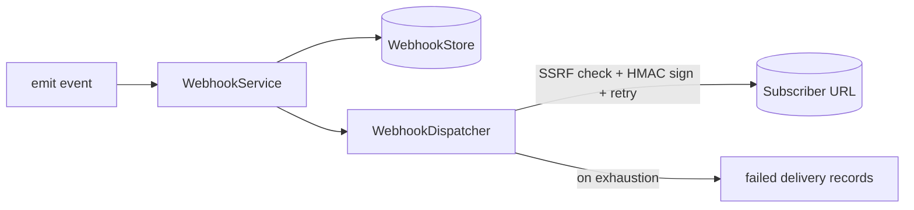

The `baselith/core/webhooks` subsystem delivers framework events to external consumers
over HTTP. It signs every payload (HMAC-SHA256), enforces an SSRF guard on
target URLs, retries with backoff, and dead-letters deliveries that exhaust
their attempts so they can be inspected and replayed.

The feature is **opt-in** (`WEBHOOKS_ENABLED`) and additive: emission is a no-op
until enabled, so call sites can fire events unconditionally.

## Architecture



- **`WebhookService`** — public facade: register endpoints, `emit()` events
  (fans out concurrently to subscribers), and `replay_delivery()`.
- **`WebhookDispatcher`** — signs, SSRF-checks, POSTs with bounded retries, and
  records the outcome.
- **`WebhookStore`** — pluggable persistence behind one Protocol:
  `InMemoryWebhookStore` by default, `PostgresWebhookStore` with
  `WEBHOOK_STORE=postgres` (see [Durable store](#durable-store-webhook_storepostgres)).

### Durable store (`WEBHOOK_STORE=postgres`)

The in-memory store is process-local: endpoints and delivery records vanish on
restart and are invisible to a second replica — and to the RQ worker, which is
where the `agent.*` events are emitted — so an endpoint registered through the
API can silently never fire in a multi-process deployment.
`get_webhook_service()` reads `WEBHOOK_STORE` once, when it builds the global
service: `memory` (the default) keeps the in-memory store, `postgres` selects
`PostgresWebhookStore` (`baselith/core/webhooks/store_postgres.py`).

- **Schema.** The `webhook_endpoints` and `webhook_deliveries` tables are
  created only by `baselith/core/db/migrations/versions/011_webhooks.py` — the store runs no DDL,
  so apply the migration first. Both tables carry the `tenant_isolation`
  row-level-security policy, including the system-tenant escape, and are listed
  in `baselith.core.db.ddl.RLS_PROTECTED_TABLES` (see
  [Multi-Tenancy › Row-Level Security](../advanced/multi-tenancy.md#defense-in-depth-row-level-security)).
- **Secrets at rest.** An endpoint's signing `secret` and its `headers` (which
  routinely carry an `Authorization` value) are encrypted with the process field
  encryptor (AES-256-GCM, keys from `DATA_ENCRYPTION_KEYS`), bound to the
  endpoint id as associated data so a ciphertext cannot be moved to another
  row. Without keys they are stored as written and the store logs
  `webhook_secrets_stored_unencrypted` once. Reading an **encrypted** row
  without keys raises `RuntimeError` rather than sign deliveries with the wrong
  secret; plaintext rows written before the keys were configured keep reading
  after they are.
- **Retention.** `PostgresWebhookStore.purge_deliveries_before(cutoff)` deletes
  delivery records created before `cutoff` (unix seconds) and returns the count.
  Nothing in the app schedules it — call it from your own job. Migration
  `012_webhook_retention_idx` adds `ix_webhook_deliveries_created_at`, so the
  sweep is an index range scan over the expired rows instead of a read of the
  whole `(tenant_id, created_at)` index.

```python
import time

from baselith.core.webhooks.store_postgres import PostgresWebhookStore

store = PostgresWebhookStore()
removed = await store.purge_deliveries_before(time.time() - 30 * 86400)
```

### Transactional outbox (`WEBHOOK_OUTBOX_ENABLED`)

`emit` delivers inside the calling process. If that process dies between the
business commit and the delivery, the event is lost: the data changed and no
subscriber heard of it. `WebhookService.publish` closes that gap. With
`WEBHOOK_OUTBOX_ENABLED=true` it writes the event to the `webhook_outbox` table
and returns; a relay running in every API process then delivers it, so any
replica can finish what a dead one started. With the outbox off, `publish` is a
plain `emit`. The terminal `agent.completed` / `agent.failed` events of the RQ
worker go through `publish`.

```python
async with get_async_cursor() as cur:
    await cur.execute("UPDATE orders SET status = 'paid' WHERE id = %s", (order_id,))
    # Same transaction: the change and its event commit together or not at all.
    await get_webhook_service().publish(
        "order.paid", {"order_id": order_id}, tenant_id=tenant, cur=cur
    )
```

- **At least once.** A relay that dies after delivering and before deleting the
  row delivers the event again. The event `id` is stable, so a receiver
  deduplicates on the `id` in the envelope.
- **Per-endpoint retries stay with the dispatcher.** The outbox guarantees the
  event was *dispatched*: a row is deleted once every subscribed endpoint was
  attempted. A failing endpoint is retried, dead-lettered and replayed through
  the delivery records, as before.
- **Failures of the pipeline itself** (database unreachable, a crash) reschedule
  the row with exponential backoff, capped at 300 s. After
  `WEBHOOK_OUTBOX_MAX_ATTEMPTS` it is parked with `status = 'dead'` and its
  `last_error`, for an operator to inspect.
- **No ordering** across events.
- **Several relays are safe.** A claim takes a lease (`FOR UPDATE SKIP LOCKED`)
  measured on the database clock, so two replicas never deliver the same row at
  once and clock skew cannot hand over a live lease. Keep
  `WEBHOOK_OUTBOX_LEASE_SECONDS` above one event's worst-case delivery time.
- **Durable only with `WEBHOOK_STORE=postgres`.** The table comes from migration
  `016_webhook_outbox`. With the `memory` store the outbox queues in-process and
  survives nothing; `cur` is ignored.

## Enabling & registering

Set `WEBHOOKS_ENABLED=true`. Register endpoints over the API or in code.

### Programmatic

```python
from baselith.core.webhooks import get_webhook_service

service = get_webhook_service()
endpoint = await service.register_endpoint(
    url="https://example.com/hooks/baselith",
    secret="whsec_...",
    event_types={"chat.completed"},   # or {"*"} for all
    tenant_id="acme",
)

# Fire an event — delivered to every matching subscriber.
await service.emit("chat.completed", {"conversation_id": "c1"}, tenant_id="acme")
```

Framework components emit through the same seam:

| Event | Emitted by | Payload highlights |
| ----- | ---------- | ------------------ |
| `loop.escalated` | An engineered loop that loses its campaign (see [Loop Engineering › Default escalation](loops.md#default-escalation-escalationpy)) | The resumable outcome payload |
| `agent.completed` | The async agent-run job when a queued run finishes (see [Task Queue › Async agent runs](task-queue.md#async-agent-runs-agentasync)) | `task_id`, `answer`, `metadata` |
| `agent.failed` | The async agent-run job when a queued run raises | `task_id`, `error` |
| `workflow.failed` (conventional — the name is the workflow's `on_failure` field) | `WorkflowScheduler` when a scheduled run fails — the scheduler is not started by the default app (see [Workflows › Scheduled workflows](workflows.md#scheduled-workflows-workflowscheduler)) | `workflow_id`, `workflow_name`, `schedule`, `status`, `error` |
| `evaluation.degraded` | The online-evaluation quality monitor when an intent's answer quality degrades — once per fleet with `CACHE_BACKEND=redis`, once per worker otherwise (see [Evaluation › Routing degradations to operators](evaluation.md#routing-degradations)) | `intent`, `source`, `state`, `window_mean`, `reference_mean`, `floor`, `samples`, `reason`, `scope` |
| `evaluation.recovered` | The same monitor when the intent recovers past the hysteresis margin | same as `evaluation.degraded`, `reason: "recovered"` |

All framework emissions are best-effort: a webhook outage never fails the run
that triggered it.

The `evaluation.*` events describe the deployment, not one tenant's request,
so they go to the endpoints of a single operator tenant,
`EVAL_ONLINE_WEBHOOK_TENANT` (default `default`): register the on-call
endpoint from that tenant with `event_types` `["evaluation.degraded",
"evaluation.recovered"]` (or `*`).

### Management API

When enabled, the `api-routers` plugin mounts a scoped management API at
`/webhooks` (gated by [capability scopes](auth.md#capability-scopes-fine-grained-authorization)):

| Method & path                              | Scope            |
| ------------------------------------------ | ---------------- |
| `POST /webhooks`                           | `webhooks:write` |
| `GET /webhooks`                            | `webhooks:read`  |
| `DELETE /webhooks/{id}`                    | `webhooks:write` |
| `GET /webhooks/deliveries`                 | `webhooks:read`  |
| `POST /webhooks/deliveries/{id}/replay`    | `webhooks:write` |

`POST /webhooks` returns the signing `secret` **once** at creation — store it;
it is never returned again (endpoint reads are redacted).

Both list routes are [cursor-paginated](../api/rest.md#pagination) (`limit`
1–200, `cursor`, answered with `next_cursor` / `has_more`). The registration
payload is bounded: `url` ≤ 2048 characters, `description` ≤ 2000, at most 100
`event_types` (each ≤ 128) and 20 custom `headers` (name ≤ 256, value ≤ 4096).
Every route is also served under `/v1` (the unprefixed paths are
[deprecated](../api/rest.md#api-versioning)).

### Tenant isolation

Every endpoint and delivery is scoped to the caller's tenant. List operations
return only the current tenant's resources, and operations that target a
specific id — `DELETE /webhooks/{id}` and `POST /webhooks/deliveries/{id}/replay`
— verify ownership before acting: a resource belonging to another tenant is
treated as **not found** (`404`), so a tenant cannot enumerate, delete, or replay
another tenant's webhooks even with a valid id. Ownership is enforced in
`WebhookService` (not just the router), so every caller is protected.

## Signed payloads

Every delivery carries an `X-Baselith-Signature` header binding a timestamp to
the exact body:

```text
X-Baselith-Signature: t=1718000000,v1=<hex_hmac_sha256>
```

The signed message is `"{t}.{body}"`. Receivers recompute the HMAC with the
shared secret and compare in constant time, rejecting stale timestamps to defeat
replays. A verification helper ships with the SDK contract:

```python
from baselith.core.webhooks import verify_signature

ok = verify_signature(
    secret="whsec_...",
    body=raw_request_body,           # bytes, exactly as received
    header=request.headers["X-Baselith-Signature"],
)
```

`verify_signature` compares the digests as UTF-8 bytes in constant time, so a
crafted header with non-ASCII characters returns `False` instead of raising
(`hmac.compare_digest` refuses a non-ASCII `str`) — a receiver built on it
answers a clean rejection, not a `500`.

`tolerance_seconds` bounds the timestamp age. Left at `None` (the default) it
reads `WEBHOOK_SIGNATURE_TOLERANCE_SECONDS` (default `300`), so the setting
governs every caller that does not pass an explicit value; pass an integer to
override it per call, or `0` to disable the freshness check.

## Delivery, retries & dead-lettering

- Each delivery is attempted up to `WEBHOOK_MAX_ATTEMPTS` times with exponential
  backoff + jitter. Non-2xx responses and network errors are retried. The jitter is drawn
  from `random.SystemRandom`, so no scanner exemption is needed.
- A delivery that exhausts its attempts is stored in the `FAILED` state — the
  dead-letter equivalent — and can be replayed via the API or
  `service.replay_delivery(delivery_id)`.
- Deliveries run concurrently (`asyncio.gather` over one `deliver()` call per
  endpoint); one failing subscriber never blocks the others. `emit()` pairs
  each result back to its endpoint with `zip(endpoints, results,
  strict=True)`, so a length mismatch between the two — which would mean a
  delivery got silently dropped or misattributed — raises instead of pairing
  wrong.

## SSRF protection

Webhook URLs are attacker-influenced, so before delivery the dispatcher rejects
non-`http(s)` schemes and any host resolving to a loopback, private, link-local,
reserved, or multicast address (cloud metadata endpoints, internal services).
Override only for trusted local development with `WEBHOOK_ALLOW_INTERNAL=true`.

The guard also **pins the connection to the validated IP** to defeat DNS
rebinding: `resolve_pinned_target()` resolves the host once and returns a
`(pinned_url, host)` pair, and the dispatcher POSTs to the pinned IP with `Host`
and TLS `sni_hostname` set to the original hostname. Redirects are not followed
(`follow_redirects=False`), so a `3xx` cannot bounce the delivery to an internal
host.

Both checks come from the shared guard in
[`baselith.core.security.ssrf`](security.md#ssrf-protection):
`WebhookService.register_endpoint()` runs `assert_url_safe()` at registration
time (so an unsafe URL is refused before it is stored), and the dispatcher runs
`resolve_pinned_target()` before every delivery (so a host that has since been
re-pointed at an internal address fails closed). Both raise `SsrfError`.

!!! warning "Deprecated: `baselith.core.webhooks.ssrf`"
    `validate_webhook_url()`, `resolve_pinned_target(url, allow_internal=...)`
    and `WebhookSSRFError` — importable from `baselith.core.webhooks.ssrf` and
    re-exported by `baselith.core.webhooks` — are a compatibility shim,
    **deprecated since 1.0 and removed in 2.0**. Nothing in the framework calls
    them any more.

| Deprecated | Use instead |
| --- | --- |
| `validate_webhook_url(url, allow_internal=x)` | `assert_url_safe(url, SsrfPolicy(allow_internal=x))` |
| `resolve_pinned_target(url, allow_internal=x)` | `resolve_pinned_target(url, SsrfPolicy(allow_internal=x))` from `baselith.core.security.ssrf` |
| `WebhookSSRFError` | `SsrfError` |

The two functions emit a `DeprecationWarning` on every call.
`WebhookSSRFError` does not: it is an alias — the same class object as
`SsrfError`, which is why `except WebhookSSRFError` still catches what the
new API raises — and a warning on the class would fire for every
`SsrfError` the framework raises. Replace the name before 2.0 anyway.

The management API never echoes the guard's reason: a rejected registration
answers a fixed `400 Webhook URL is not an allowed destination.` and the
detail ("resolves to a blocked address 10.0.0.5", "could not resolve host")
goes to the operator log only, so a `webhooks:write` holder cannot use the
endpoint as a DNS/IP oracle for the internal network.

## Reserved delivery headers

An endpoint's static `headers` are sent with every delivery, but a fixed set of
names belongs to the dispatcher and can never be supplied by a subscriber:
`X-Baselith-Signature`, `Host`, `Content-Type`, `Content-Length`,
`Transfer-Encoding`, `Connection` and `User-Agent`
(`baselith.core.webhooks.signing.RESERVED_DELIVERY_HEADERS`, matched case-insensitively).
The signature is the receiver's only proof of origin, the framing headers
describe the signed body, and `Host` is the SSRF pin — letting any of them be
overridden would let a tenant forge or strip exactly the guarantees the
subsystem exists to provide.

Enforced twice: registration rejects them (`422` from the management API,
`ValueError` from `WebhookService.register_endpoint`), and at send time the
dispatcher filters endpoint headers against the set before layering its own on
top, so a record that reached the store some other way still cannot win.

## Outbound connection budget

The dispatcher's lazily-built `httpx.AsyncClient` bounds concurrent sockets to
`WEBHOOK_MAX_CONNECTIONS` and runs **without keep-alive**. Deliveries target a
pinned IP with `Host`/SNI set per request, while httpx pools connections by
`(scheme, host, port)` alone — a kept-alive TLS session validated for one
hostname could be handed to a delivery for a different hostname resolving to
the same address (a shared CDN edge). One handshake per delivery is the price
of never mixing them up.

## Configuration

| Variable                              | Default | Description                                    |
| ------------------------------------- | ------- | ---------------------------------------------- |
| `WEBHOOKS_ENABLED`                    | `false` | Master switch for the subsystem                |
| `WEBHOOK_STORE`                       | `memory` | `memory` (process-local) or `postgres` (needs migration 011) |
| `WEBHOOK_TIMEOUT_SECONDS`             | `10`    | Per-delivery HTTP timeout                      |
| `WEBHOOK_MAX_CONNECTIONS`             | `20`    | Cap on concurrent outbound delivery sockets    |
| `WEBHOOK_MAX_ATTEMPTS`                | `4`     | Delivery attempts before dead-lettering        |
| `WEBHOOK_RETRY_BACKOFF_SECONDS`       | `1`     | Base backoff (exponential + jitter)            |
| `WEBHOOK_OUTBOX_ENABLED`              | `false` | `publish` queues events in the transactional outbox |
| `WEBHOOK_OUTBOX_POLL_SECONDS`         | `2`     | Seconds between polls when the outbox is empty |
| `WEBHOOK_OUTBOX_BATCH_SIZE`           | `50`    | Rows claimed per poll                          |
| `WEBHOOK_OUTBOX_LEASE_SECONDS`        | `120`   | How long a relay owns a claimed row            |
| `WEBHOOK_OUTBOX_MAX_ATTEMPTS`         | `8`     | Dispatch attempts before a row is parked as dead |
| `WEBHOOK_SIGNATURE_TOLERANCE_SECONDS` | `300`   | Max signature age `verify_signature` accepts when called without `tolerance_seconds`; `0` disables the check |
| `WEBHOOK_ALLOW_INTERNAL`              | `false` | Bypass the SSRF guard (local dev only)         |
| `WEBHOOK_MAX_ENDPOINTS_PER_TENANT`    | `50`    | Per-tenant registration cap                    |
